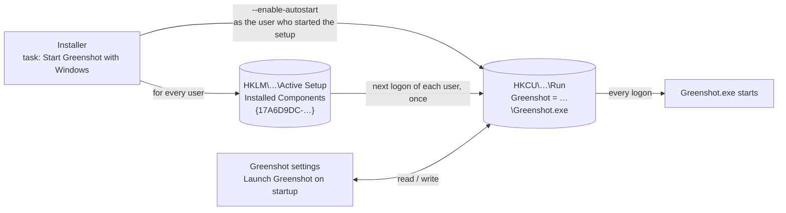
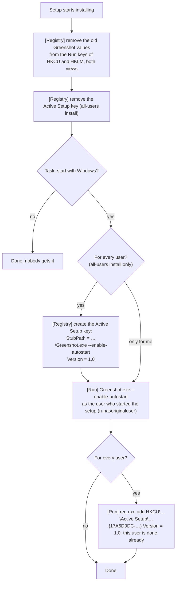
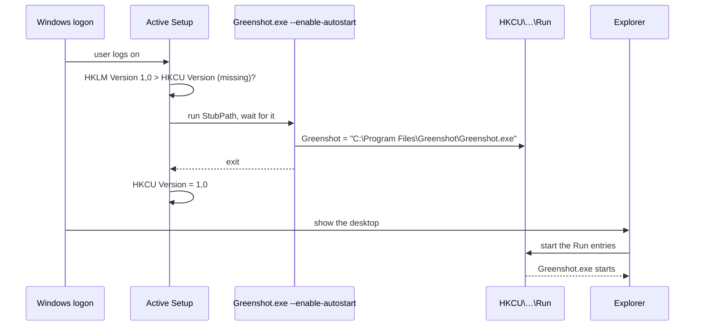
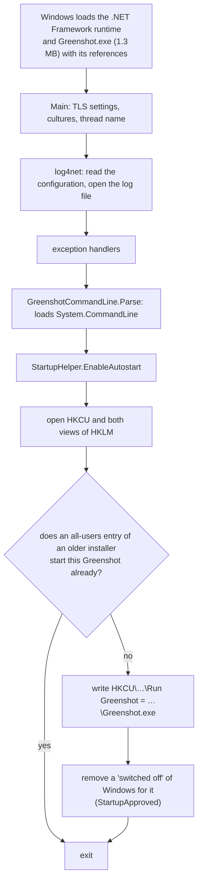
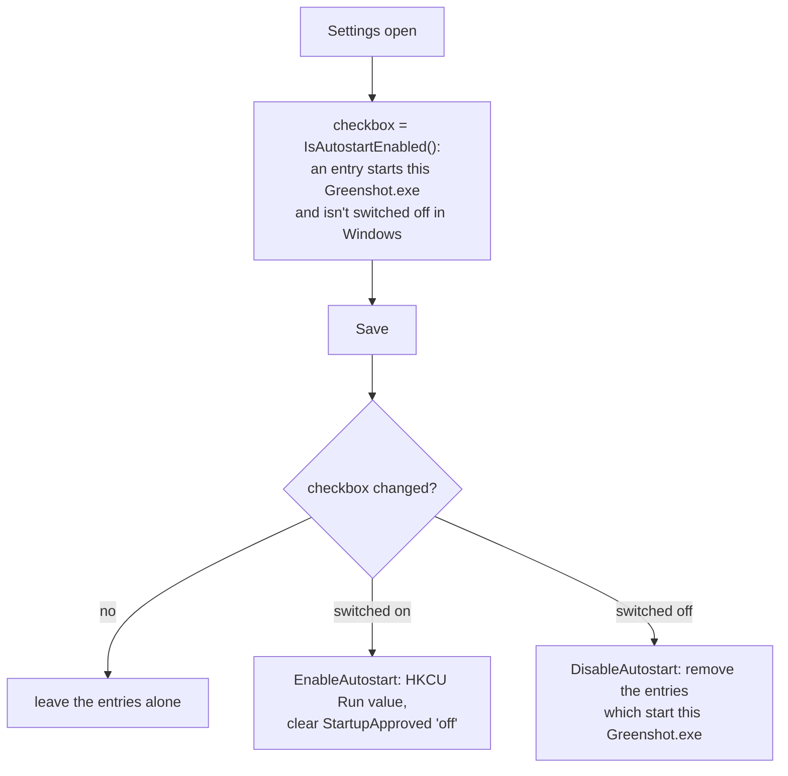

# Starting Greenshot with Windows

Greenshot starts with Windows through one registry value: `Greenshot` in the Run key of the user,
`HKCU\Software\Microsoft\Windows\CurrentVersion\Run`, with the quoted path of Greenshot.exe.
Every user decides for themselves, with the checkbox "Launch Greenshot on startup" in the settings; it needs no administrator rights.

Three parts work together:

| Part | When | What it does |
| --- | --- | --- |
| Installer | install, update, uninstall | asks if and for whom, sets it up for the user who runs the setup, registers Active Setup for every other user |
| Active Setup (Windows) | the next logon of every user | runs the registered command once per user, which writes that user's Run value |
| Greenshot | the checkbox in the settings | reads and changes the Run value of the user |

## The installer

The task "Start Greenshot with Windows start" sets it up for the user who started the setup. An all-users install has two choices below it:

- **For every user of this computer** (default, so an update of an all-users install keeps starting Greenshot for everyone):
  every user gets the start with Windows at their next logon, and can switch it off in the settings.
- **Only for me**: only the user who started the setup.

A per-user install only has the task, for the current user.

Notes:

- "As the user who started the setup" matters: when an administrator elevates the setup with their own account, for example on the computer of a family member,
  the HKCU of the setup is the administrator's. `runasoriginaluser` writes the Run value of the person who is logged on.
- The old values are removed first because older installers wrote the value for all users to HKLM, which a user without administrator rights can't switch off.
- Without the "every user" choice the Active Setup key is removed, so no new user gets the start with Windows.
- Unattended: `/TASKS="startup\allusers"` or `/TASKS="startup\currentuser"` for an all-users install, `/TASKS="startup"` for a per-user install,
  `/MERGETASKS="!startup"` for none.
- `AutostartComponentVersion` in `tasks-icons-reg.iss` is the Active Setup version. Raise it only to set up the start with Windows for every user
  once more, also for those who switched it off since.

### Uninstall

The uninstaller removes the Run value of the user who uninstalls, if it starts this Greenshot.exe, and that user's Active Setup marker;
the HKLM Active Setup key goes with the other registry entries of the setup.
The Run values of other users can't be reached: Windows skips a Run value whose file doesn't exist anymore.

## Active Setup at the logon

Active Setup is a Windows mechanism for setting something up once per user. For every key below
`HKLM\Software\Microsoft\Active Setup\Installed Components`, Windows compares the `Version` with the one in the same key below HKCU.
When the HKCU key is missing or older, it runs the `StubPath` and then writes the version to HKCU, so it doesn't run again.

Windows waits for the `StubPath` before it shows the desktop, which is why `--enable-autostart` only writes the value and exits:
a command that keeps running delays the logon. Greenshot itself is started from the Run value it just wrote, in the same logon.
That Active Setup runs before the Run entries are started is what's expected; it still has to be confirmed on a real logon of a second user.

A user who switches the start off in the settings keeps it off: Active Setup only runs again when the `Version` in HKLM is raised.

## What `Greenshot.exe --enable-autostart` does

It's a startup option of Greenshot.exe, handled in `GreenshotMain.Main` before anything of the application starts:

No greenshot.ini, no plugins, no window, no single-instance check. Still, the whole runtime is loaded for writing one registry value:
on the development machine `Greenshot.exe --no-run`, which goes through the same start, takes about 220 ms warm and 430 ms cold.
At a first logon nothing is in the file cache yet, so it's likely more, and the user waits for it before seeing the desktop.
With .NET 10 the runtime and Greenshot get bigger, especially self-contained.

## Alternatives for `--enable-autostart`

The work itself is small: write one string value to HKCU. The only real logic, not adding a second entry when an all-users entry
from an older installer already starts Greenshot, isn't needed anymore once the installer has removed those entries,
and clearing a Windows "switched off" isn't needed for a user who never had the entry.

| Option | Size / start | Window | Notes |
| --- | --- | --- | --- |
| `Greenshot.exe --enable-autostart` (now) | 1.3 MB + .NET runtime, ~0.2–0.5 s or more | none | grows with .NET 10; logs to the Greenshot log |
| `greenshot-proxy.exe --enable-autostart` | 42 KB native, no C runtime, milliseconds | none (`/SUBSYSTEM:WINDOWS`) | already installed next to Greenshot.exe and already links advapi32; it's the "Windows shell integration" executable, so it fits there. The path is Greenshot.exe next to itself |
| `reg.exe add HKCU\…\Run /v Greenshot /d "\"…\Greenshot.exe\"" /f` as StubPath | part of Windows | console program: probably a short console window at the logon | no code of our own; quoting the path inside the StubPath is fiddly; the setup can use it hidden (`runhidden`), Active Setup can't |
| Write the HKCU value directly from the setup | – | – | only reaches the HKCU of the setup's account, not the original user, nor other users: doesn't replace Active Setup |
| Scheduled task at logon, Startup folder link for all users | – | – | other mechanisms with their own problems (users can't remove them without admin rights) |

**Proposal:** move `--enable-autostart` to `greenshot-proxy.exe`: a few lines of C with `RegSetValueExW`,
the setup and the Active Setup `StubPath` call `"…\greenshot-proxy.exe" --enable-autostart`, and Greenshot.exe loses the option.
The checks of `StartupHelper` stay in Greenshot, for the checkbox in the settings.

## Greenshot

`StartupHelper` reads and writes the entries for the checkbox in the settings:

- **Is it on?** When the Run key of the user, or the one of the machine (64-bit and 32-bit view, from an older installer), starts this Greenshot.exe,
  and the entry isn't switched off in Windows (Task Manager > Startup apps, Settings > Apps > Startup). Windows keeps that switch in
  `…\Explorer\StartupApproved\Run` (`Run32` for the 32-bit Run key of the machine): the first byte of the value is odd when it's off.
  An entry for another Greenshot.exe, e.g. a portable one, doesn't count.
- **Switching it on** writes the Run value of the user, unless an entry of the machine already starts this Greenshot (it would start twice),
  and removes a "switched off" of Windows for it.
- **Switching it off** removes the entries which start this Greenshot.exe. The one of the machine needs administrator rights; without them it's only logged.
- The settings only change the entries when the checkbox was changed.

Not handled yet, for the Self-Service troubleshooter: links in the Startup folders, entries of other Greenshot installations and duplicates.
