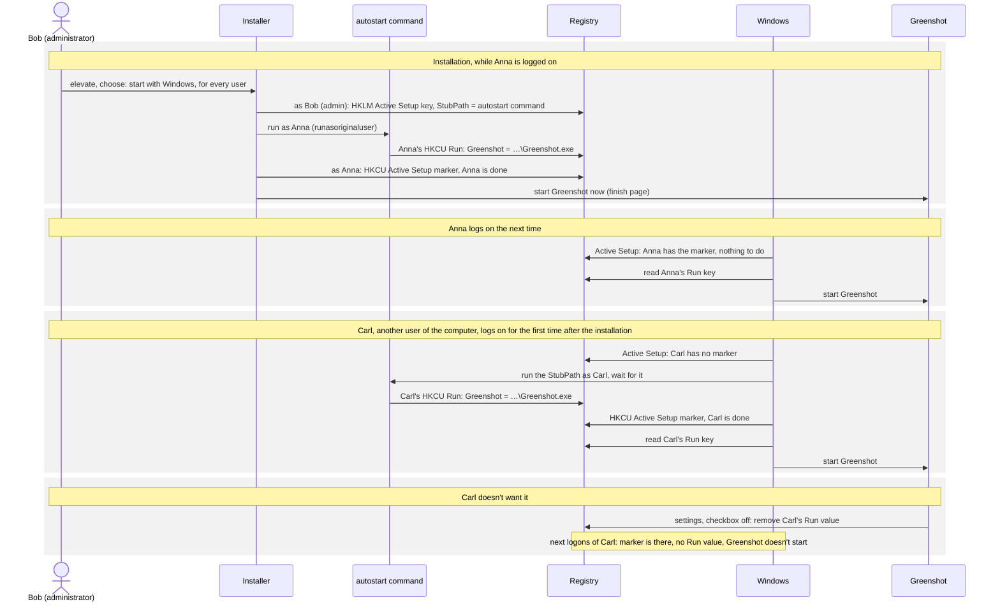
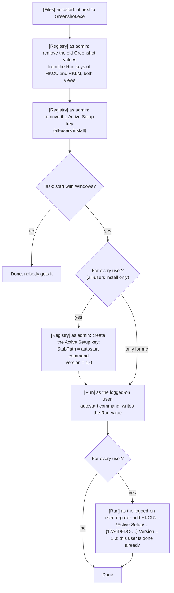
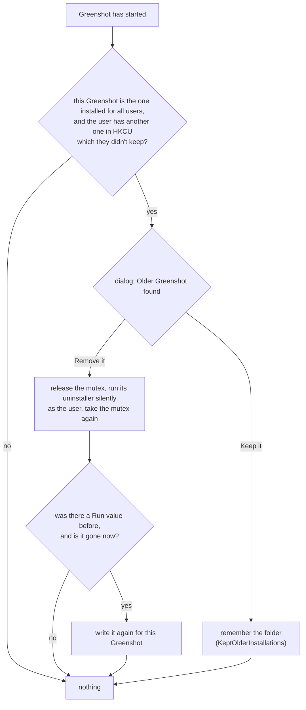
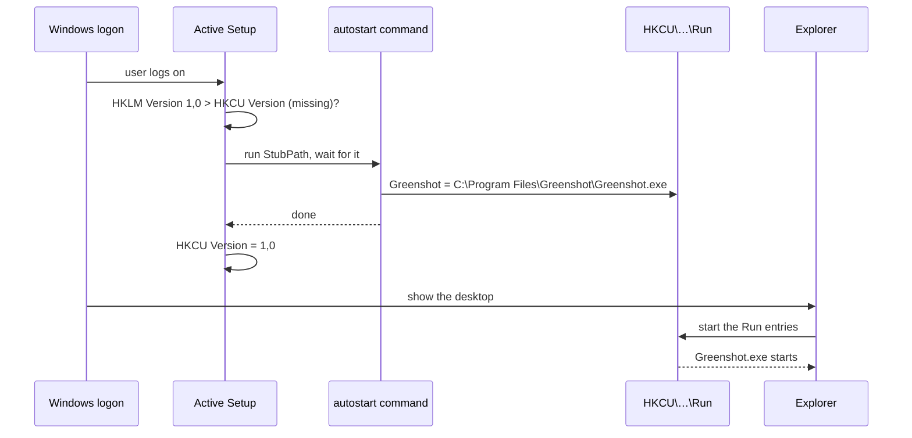
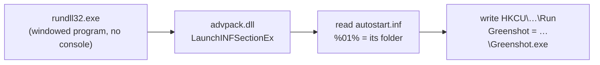
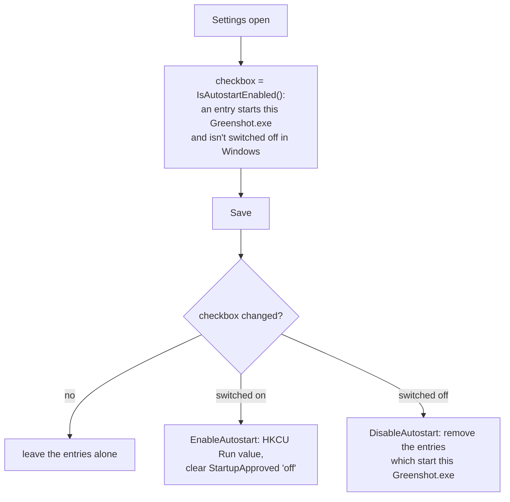

# Starting Greenshot with Windows

## In short

What makes Greenshot start with Windows is one registry value per user: `Greenshot` in the Run key of that user,
`HKCU\Software\Microsoft\Windows\CurrentVersion\Run`, with the quoted path of Greenshot.exe.
Windows reads it at every logon of that user and starts Greenshot. Nothing else starts Greenshot with Windows.

Everything below is only about **who writes that value, and when**:

| Who | Runs as | When | Does |
| --- | --- | --- | --- |
| **Installer** | the administrator who elevated it | install / update | asks *whether* and *for whom*. For every user: registers Greenshot in Active Setup (HKLM), so Windows will write the value for each user later |
| **Installer** | the user who is logged on (`runasoriginaluser`) | install / update, at the end | writes the value for that user right away, with the autostart command |
| **Windows, Active Setup** | each user | the next logon of each user, **once** | runs the autostart command for that user, which writes the value |
| **Windows, Run key** | each user | **every** logon | starts Greenshot.exe if the value is there |
| **Greenshot** | the user | when the checkbox "Launch Greenshot on startup" in the settings is changed | writes or removes the value of that user. The user's own decision, no administrator rights needed |
| **Greenshot** | the user | its first start after the setup | offers to remove an older Greenshot the user installed "for me only", see [below](#an-older-greenshot-installed-for-me-only) |
| **Uninstaller** | the administrator / the user | uninstall | removes the Active Setup registration and the value of the uninstalling user |

The **autostart command** writes the value for the current user, nothing else; Greenshot isn't involved:

```
"C:\Windows\System32\rundll32.exe" advpack.dll,LaunchINFSectionEx "<app>\autostart.inf",DefaultInstall,,4
```

`autostart.inf` is installed next to Greenshot.exe, see [The autostart command](#the-autostart-command).

### Example: an administrator installs Greenshot on a family member's computer

Anna is logged on, Bob types his administrator password when the setup asks for it, and chooses "for every user of this computer".



With "only for me", the Active Setup part is left out: only Anna gets the value, Carl has to switch it on in the settings himself.

## The installer in detail

The task "Start Greenshot with Windows start" sets it up for the user who started the setup. An all-users install has two choices below it:

- **For every user of this computer** (default, so an update of an all-users install keeps starting Greenshot for everyone):
  every user gets the start with Windows at their next logon, and can switch it off in the settings.
- **Only for me**: only the user who started the setup.

A per-user install only has the task, for the current user.

The steps in the order the setup does them. The `[Registry]` steps run as the account of the setup (the administrator for an all-users install),
the `[Run]` steps marked "as the logged-on user" run as the user who started the setup:



Notes:

- "As the user who started the setup" matters: when an administrator elevates the setup with their own account, for example on the computer of a family member,
  the HKCU of the setup is the administrator's. `runasoriginaluser` writes the Run value of the person who is logged on.
- The old values are removed first because older installers wrote the value for all users to HKLM, which a user without administrator rights can't switch off.
- Without the "every user" choice the Active Setup key is removed, so no new user gets the start with Windows.
- Unattended: `/TASKS="startup,startup\allusers"` or `/TASKS="startup,startup\currentuser"` for an all-users install, `/TASKS="startup"` for a per-user install,
  `/MERGETASKS="!startup"` for none.
- `AutostartComponentVersion` in `tasks-icons-reg.iss` is the Active Setup version. Raise it only to set up the start with Windows for every user
  once more, also for those who switched it off since.
- The `reg.exe` for the marker is a console program, the setup runs it hidden (`runhidden`).

### Installed "for me only"

The setup still offers to install Greenshot for the current user only (the dialog at the start, `/CURRENTUSER` unattended),
for people who can't install for all users. The dialog warns about it (English and German texts in `[Messages]` of `tasks-icons-reg.iss`):
installed for one user, Greenshot is in the profile, where every program the user runs can change or replace its files;
in Program Files only administrators can.

### An older Greenshot installed "for me only"

Greenshot 1.3 installed for the current user by default (`%LOCALAPPDATA%\Programs\Greenshot`). The setup for all users doesn't see such an
installation: Inno Setup only finds the previous installation in the registry of the install mode it runs in (HKLM for all users,
HKCU for one user). Without help both would stay installed, and uninstalling the old one later would remove the `Greenshot` Run value,
also when it starts the new Greenshot already.

So Greenshot itself asks the user (`PerUserInstallCleanup`), after its start: when it runs from the folder of the installation for all users
(`InstallLocation` in `HKLM\…\Uninstall\Greenshot_is1`) and the user still has a different one in `HKCU\…\Uninstall\Greenshot_is1`,
a dialog "Older Greenshot found" shows the version and both folders, explains why the older one isn't needed
(in the profile every program the user runs can change its files, and it could be started instead), and offers **Remove it** or **Keep it**.

- **Remove it:** Greenshot releases its single instance mutex (the old uninstaller refuses to run while it exists, `AppMutex` of its setup),
  runs the old uninstaller silently as the user, and takes the mutex again. When the Run value was there before and the old uninstaller removed it,
  it writes it again for this Greenshot. The same for `PrintScreenKeyForSnippingEnabled` in `HKCU\Control Panel\Keyboard`: the 1.3 setup set it
  (component "disablesnippingtool", the default on Windows 11), its uninstaller removes it, and the Print key would open the Snipping Tool again.
  If the uninstaller fails, a message says so and points to Settings > Apps.
  Everything else the 1.3 uninstaller removes is its own: its folder, its Start menu shortcuts in the profile, its uninstall key, and its file type
  entries in `HKCU\Software\Classes` (`.greenshot` → `Greenshot`), which would otherwise hide the ones of this Greenshot.
  Checked in Windows Sandbox by comparing the files and registry entries of both installations before and after.
- **Keep it:** the folder is added to `KeptOlderInstallations` in greenshot.ini, the user isn't asked again for it.

This happens for the one who is logged on right after the setup (the setup starts Greenshot) and for every other user at their first start of the new Greenshot.
The settings (`%APPDATA%\Greenshot`) stay, the uninstaller of 1.3 doesn't remove them.



### Uninstall

The uninstaller removes the Run value of the user who uninstalls, if it starts this Greenshot.exe, and that user's Active Setup marker;
the HKLM Active Setup key and autostart.inf go with the other entries and files of the setup.
The Run values of other users can't be reached: Windows skips a Run value whose file doesn't exist anymore.

## Active Setup at the logon

Active Setup is a Windows mechanism for setting something up once per user. For every key below
`HKLM\Software\Microsoft\Active Setup\Installed Components`, Windows compares the `Version` with the one in the same key below HKCU.
When the HKCU key is missing or older, it runs the `StubPath` and then writes the version to HKCU, so it doesn't run again.



Windows waits for the `StubPath` before it shows the desktop, so it must be quick and must not keep running.
Greenshot itself is started from the Run value the command just wrote, in the same logon.
That Active Setup runs before the Run entries are started is what's expected; it still has to be confirmed on a real logon of a second user.

A user who switches the start off in the settings keeps it off: Active Setup only runs again when the `Version` in HKLM is raised.

## The autostart command

`autostart.inf` (in `src/Greenshot-Installer/additional_files`) is a few lines, the same for Greenshot and Greenshot Light:

```ini
[Version]
Signature="$Windows NT$"

[DefaultInstall]
AddReg=Autostart.AddReg

[Autostart.AddReg]
HKCU,"Software\Microsoft\Windows\CurrentVersion\Run","Greenshot",0x00000000,"""%01%\Greenshot.exe"""
```

`%01%` is the folder of the INF file, which is the folder of Greenshot.exe, so the file has no path in it and works for every install folder.
`rundll32.exe advpack.dll,LaunchINFSectionEx` applies the `DefaultInstall` section; the last parameter `4` means quiet.
advpack is part of Windows; Active Setup was made for exactly this (Internet Explorer and Windows components use INF files the same way).



It doesn't need the checks Greenshot does for the settings (old all-users entries, a "switched off" of Windows):
the installer has removed the old entries before, and a user who never had the value has nothing switched off.

### Why this command

Tested in Windows Sandbox, as the administrator and as a standard user, with a path with spaces and one with umlauts (`C:\Prögramme Jörg\Greenshot`):

| Option | Result |
| --- | --- |
| **`rundll32 advpack.dll,LaunchINFSectionEx`** (chosen) | works for both users and both paths, about 100–150 ms (500 ms with a fresh profile), no window, part of Windows |
| `rundll32 setupapi.dll,InstallHinfSection` | works for the administrator; a standard user gets an "Error" dialog and the command doesn't end |
| `regedit.exe /s autostart.reg` | regedit asks for elevation (`highestAvailable` in its manifest): an administrator gets a UAC prompt at the logon. Not usable |
| `reg.exe add …` | works, but a console program: Active Setup can't hide its window |
| `Greenshot.exe --enable-autostart` (an earlier version of this change) | loads the whole .NET runtime for one value: about 220 ms warm, 430 ms cold, more at a first logon and with .NET 10. Removed |
| `greenshot-proxy.exe` with an option | would be quick, but is our own code, and Greenshot Light has no greenshot-proxy.exe |
| Writing HKCU from the setup | only reaches the account of the setup, not the logged-on user, nor other users |

A policy which blocks registry editing tools (DisableRegistryTools) is about regedit and reg.exe; companies with such policies usually start programs through Group Policy anyway.

## Greenshot: the checkbox in the settings

This is the only part of Greenshot itself which takes part.
`StartupHelper` reads and writes the entries for the checkbox in the settings:

- **Is it on?** When the Run key of the user, or the one of the machine (64-bit and 32-bit view, from an older installer), starts this Greenshot.exe,
  and the entry isn't switched off in Windows (Task Manager > Startup apps, Settings > Apps > Startup). Windows keeps that switch in
  `…\Explorer\StartupApproved\Run` (`Run32` for the 32-bit Run key of the machine): the first byte of the value is odd when it's off.
  An entry for another Greenshot.exe, e.g. a portable one, doesn't count.
- **Switching it on** writes the Run value of the user, unless an entry of the machine already starts this Greenshot (it would start twice),
  and removes a "switched off" of Windows for it.
- **Switching it off** removes the entries which start this Greenshot.exe. The one of the machine needs administrator rights; without them it's only logged.
- The settings only change the entries when the checkbox was changed.



Not handled yet, for the Self-Service troubleshooter: links in the Startup folders, entries of other Greenshot installations and duplicates.
