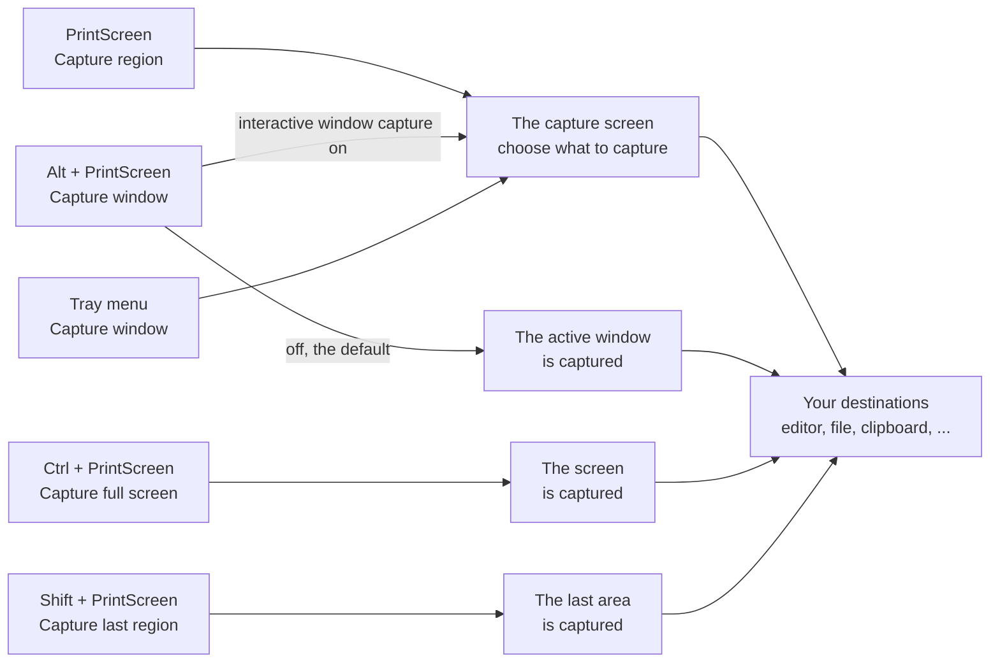
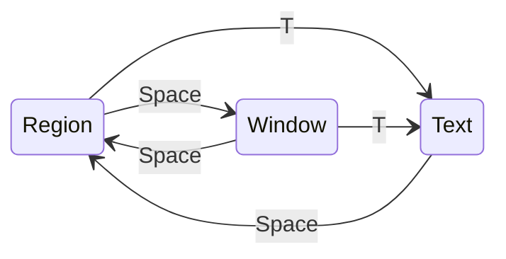

# Capturing with Greenshot 1.3

This guide explains how taking a screenshot works in Greenshot 1.3, the current release: the ways to start a capture, the modes you
can choose from while you select (region, window and text), every key, what Greenshot remembers, and the settings which change how
capturing works.

Greenshot 1.4 is still in development and captures differently, its guide is in [vNext/capture-user-guide.md](vNext/capture-user-guide.md).

- [Starting a capture](#starting-a-capture)
- [The capture screen](#the-capture-screen)
- [The modes](#the-modes)
  - [Region](#region)
  - [Window](#window)
  - [Text](#text)
- [The zoomer and the other helpers](#the-zoomer-and-the-other-helpers)
- [All keys](#all-keys)
- [What Greenshot remembers](#what-greenshot-remembers)
- [Settings which change capturing](#settings-which-change-capturing)
- [Good to know](#good-to-know)

## Starting a capture

| Capture | Default hotkey | What happens |
|---|---|---|
| Capture region | `PrintScreen` | The capture screen opens in the region mode. |
| Capture window | `Alt` + `PrintScreen` | Captures the active window right away. With *Use interactive window capture mode* turned on (Settings, Capture tab) the capture screen opens in the window mode instead. |
| Capture full screen | `Ctrl` + `PrintScreen` | Captures the monitor with the mouse right away, without the capture screen. |
| Capture last region | `Shift` + `PrintScreen` | Captures the same area as your last capture again, without the capture screen. |
| Capture Internet Explorer | `Shift` + `Ctrl` + `PrintScreen` | Captures the page shown in Internet Explorer, when *Internet Explorer capture* is turned on. |
| Open image from clipboard | none | Opens the image on the clipboard. |

The same captures are in the menu of the Greenshot icon next to the clock. There, *Capture window* always opens the capture screen
in the window mode. With more than one monitor, *Capture full screen* has a sub menu: *all* monitors, or one of them.
*Capture window from list* lists the open windows and captures the one you pick, without the capture screen.

A capture started from the menu never contains the mouse cursor, it would only show the menu. You can change the hotkeys in the
settings, on the General tab.

## The capture screen

Greenshot takes a picture of all your monitors first, then shows it on top of everything. What you see is a frozen picture:
nothing on the screen changes while you select, so a tooltip or an open menu stays where it was.
You choose what to capture in this picture, and only that part is used.

On top of the picture you see the **selection** in green, with its width above it, its height left of it and its size in the middle,
and the **zoomer**, a round magnifier next to the mouse.

`Esc` closes the capture screen without capturing anything. Releasing the mouse, clicking or pressing `Enter` (depending on the mode)
captures the selection, and Greenshot sends it to your destinations (the editor, a file, the clipboard, ...).

## The modes

The capture screen has three modes. A capture started with *Capture region* begins in the region mode, one started with
*Capture window* in the window mode.

| Mode | You select | You capture with | Zoomer |
|---|---|---|---|
| Region | a rectangle, by dragging | releasing the mouse, or `Enter` twice | yes |
| Window | the window (or a part of it) under the mouse | a click or `Enter` | no |
| Text | words of text found on the screen | dragging over words, or a click on a word | yes |

### Region

Drag a rectangle with the mouse: press the left mouse button where it should start, move to where it should end, and let go.
That captures the rectangle. The size shown is the size of the capture: the pixel under the mouse belongs to it.

You can also do it all with the keyboard: move the mouse with the arrow keys, press `Enter` to start, move to the other corner,
and press `Enter` again to capture.

- **Arrow keys** move the mouse one pixel, **`Ctrl` + arrow keys** ten pixels. Together with the zoomer this places a corner exactly.
- **Hold `Shift`** while dragging to keep the selection to one direction: the first move after pressing `Shift` decides whether only
  the width or only the height changes. Let go of `Shift` to change both again.
- A click without dragging captures nothing, you can just try again.
- Before you start dragging, two dotted lines cross the whole screen at the mouse, with the mouse position next to it.

### Window

Press `Space` to switch between the region and the window mode. The selection follows the window under the mouse: it slides from
window to window as you move. Click, or press `Enter`, to capture it.

- Greenshot selects the innermost window under the mouse, e.g. a panel or a toolbar inside a program, when the program is built from
  several windows. Move to the outer edge of a program window to select the whole window.
- What is captured is the part of the frozen picture: a window lying on top of the selected one is in the capture too, and a part
  outside of the screens is left out. To capture a window on its own, also where it is covered, use *Capture window* without the
  interactive mode (the default) or *Capture window from list*.
- `D` shows or hides technical details of the selected window next to it: its number and its title (or the name of the program).
  This helps when you report a problem with a certain program.

### Text

Press `T` to capture text. Greenshot reads the text on the screen with the text recognition of Windows, which can take a moment.
Then every line of text it found gets a frame.

- **Drag over the text** to select words: the words inside the rectangle are highlighted while you drag. Dragging works like in the
  region mode, with `Enter`, the arrow keys and `Shift`.
- **Click a word** to take just that word.

The text of the selected words is copied to the clipboard. No image is captured in this mode, nothing goes to your destinations.

The text mode needs the Windows 10 plug-in of Greenshot (an option of the installer) and a language with text recognition installed
in Windows (Time and language, Language and region). Greenshot reads the text in the languages of your Windows profile. Without them,
no lines are shown and nothing can be selected; press `Space` to go back to the region mode.

## The zoomer and the other helpers

The **zoomer** shows the pixels around the mouse greatly enlarged, with a crosshair on the pixel under the mouse.

- `Z` shows or hides it in the region mode. This is the same as *Show magnifier* in the settings (Capture tab).
- It is shown in the region and text modes, not in the window mode.
- It moves out of the way when it would cover the selection or go off the screen.
- It can be made see-through with the setting `ZoomerOpacity`, see [Settings](#settings-which-change-capturing).

`M` shows or hides the mouse cursor in the capture, for this capture only.

`F` takes the capture screen from the front, so other windows which want to be on top can show above it, and brings it back to the front.

In a remote desktop session there are no animations and no crosshair lines, because every change of the screen has to be sent over
the network.

## All keys

**In every mode**

| Key | What it does |
|---|---|
| `Esc` | Cancel the capture |
| `Space` | Switch between region and window (from text: back to region) |
| `T` | Capture text |
| `M` | Show or hide the mouse cursor in the capture |
| `F` | Keep the capture screen in front of other windows, or not |
| `↑` `↓` `←` `→` | Move the mouse one pixel |
| `Ctrl` + `↑` `↓` `←` `→` | Move the mouse ten pixels |

**Region and text**

| Key | What it does |
|---|---|
| `Enter` | Start or finish the selection |
| hold `Shift` | Keep the selection to one direction |
| `Z` | Show or hide the zoomer (region mode) |

**Window**

| Key | What it does |
|---|---|
| `Enter` | Capture the window |
| `D` | Show or hide window details |

**With the mouse**

| Action | What it does |
|---|---|
| Drag (region, text) | Select a rectangle, letting go captures it |
| Click (window) | Capture the window |
| Click on a word (text) | Copy that word |

## What Greenshot remembers

| What | Changed with | Remembered | Setting in greenshot.ini |
|---|---|---|---|
| Zoomer shown or hidden | `Z` | yes, also in the settings as *Show magnifier* | `ZoomerEnabled` |
| The area of your last capture | a capture with the capture screen | yes, for *Capture last region* | `LastCapturedRegion` |
| Mouse cursor shown or hidden | `M` | no, only for this capture | starts from `CaptureMousepointer` |
| Window details | `D` | no | |
| The mode | `Space`, `T` | no, each capture starts in the mode you started it with | |

## Settings which change capturing

**In the settings window**

| Where | Setting | What it does |
|---|---|---|
| General tab, *Hotkeys* | Capture region, window, full screen, last region, Internet Explorer | The hotkeys which start a capture. |
| Capture tab | *Capture mousepointer* | Whether the mouse cursor is in the capture. `M` changes it for one capture. |
| Capture tab | *Play camera sound* | A camera sound when a capture is taken. |
| Capture tab | *Show notifications* | A notification of the tray icon when a capture is taken. |
| Capture tab | *Show magnifier* | The zoomer, the same as `Z`. |
| Capture tab | *Milliseconds to wait before capture* | Time to wait before the picture is taken, e.g. so the menu of the tray icon can close. |
| Capture tab, *Window capture* | *Use interactive window capture mode* | Whether the window hotkey opens the capture screen in the window mode, or captures the active window right away (the default). |
| Capture tab, *Window capture* | *Window capture mode* | How a window is captured on its own (the window hotkey, *Capture window from list*): *Automatically*, *As displayed* (cut from the screen), *Use default color* or *Use custom color* (the window without what covers it), *Preserve transparency*. |
| Capture tab | *Internet Explorer capture* | Turns the Internet Explorer captures on or off. |
| Expert tab | *Make some optimizations for usage with remote desktop* | No animations and no crosshair lines, also outside of a remote session. In a remote session this happens on its own. |

**Only in greenshot.ini**

greenshot.ini is in `%APPDATA%\Greenshot`, the portable Greenshot keeps it next to Greenshot.exe. Change it while Greenshot isn't running.
All of these are in the `[Core]` section.

| Setting | Default | What it does |
|---|---|---|
| `ZoomerOpacity` | `1` | How see-through the zoomer is, from 0 (invisible) to 1 (solid); 0.7 is a good value to see a bit of the screen through it. |
| `LastCapturedRegion` | | The area *Capture last region* captures. |
| `ScreenCaptureMode` | `Auto` | What *Capture full screen* captures: `Auto` the monitor with the mouse, `FullScreen` all monitors, `Fixed` the monitor of `ScreenToCapture`. |
| `ScreenToCapture` | `1` | The monitor for `ScreenCaptureMode=Fixed`. |
| `WindowCaptureRemoveCorners` | `True` | Cut the round corners off a window capture. |

## Good to know

- **Several monitors:** the capture screen covers all of them, and you can select across monitors.
- **Nothing changes while you select:** the capture screen shows the picture taken when the capture started. To capture something which
  only appears later, set a wait time in the settings, or start the capture when it is visible.
