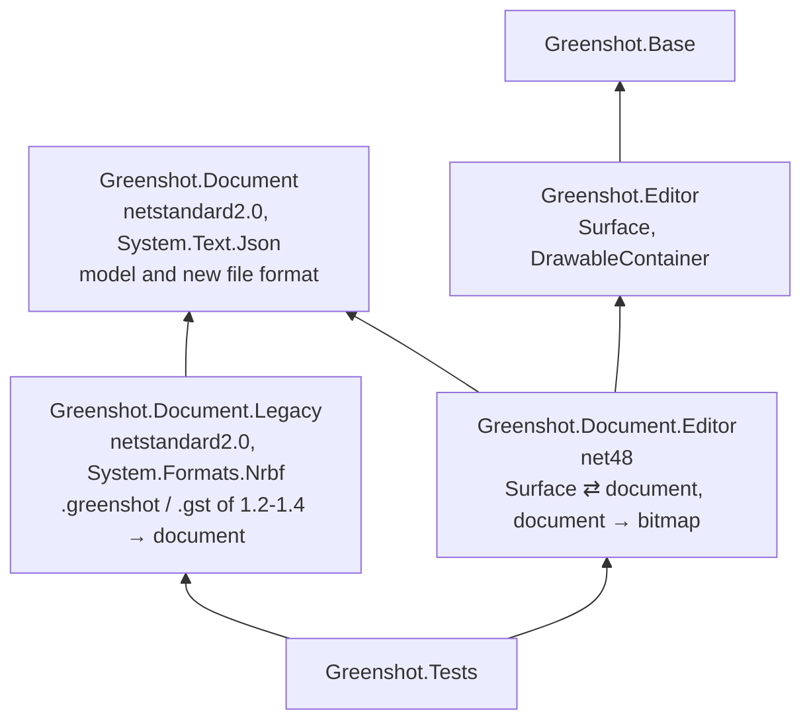
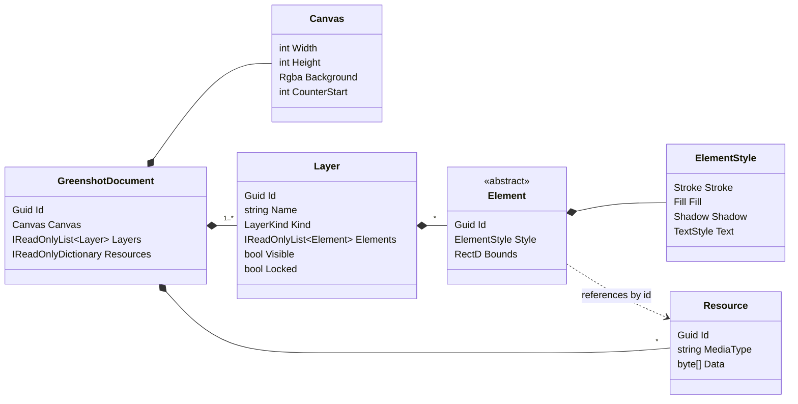
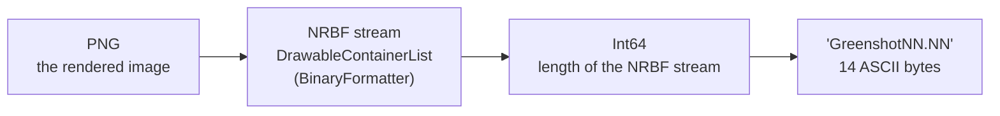
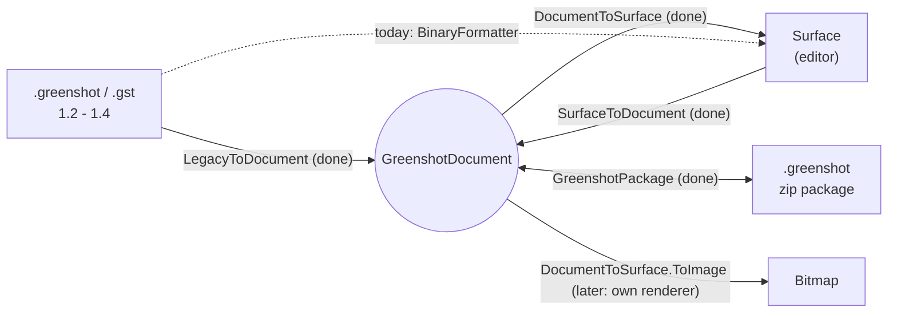

# Greenshot document model and file format

Experimental. The document model runs in parallel with the editor's `Surface` / `DrawableContainer`. It will
replace them step by step, and nothing in a release build uses it yet.

## Why

The editor keeps its content in `Surface` and `DrawableContainer` objects. These need System.Drawing and WinForms,
keep their settings in untyped field bags (`FieldType.LINE_COLOR`, ...), and are saved with BinaryFormatter, which
.NET 9+ no longer has. The `GreenshotDocument` holds the same content as plain data, so that:

- capture, recipes, export and the file format can work without the editor
- the same code runs on .NET Framework 4.8 today and on .NET 10 (and other platforms) later
- a new editor or renderer can be built on it, while the current editor keeps working

## Projects

Arrows point to the referenced project.

- **Greenshot.Document** holds the model and its file format (`GreenshotPackage`, zip + JSON). It targets
  netstandard2.0, so one binary loads in .NET Framework 4.8 and in .NET 10, with no multi-targeting. Its only reference
  is System.Text.Json (part of .NET 10), so neither System.Drawing nor Windows code can creep in.
- **Greenshot.Document.Legacy** reads the BinaryFormatter files of Greenshot 1.2 - 1.4 without BinaryFormatter.
  It is its own project so that the model doesn't carry the NRBF reader or the frozen 1.x schema, and so that legacy
  support can later be removed by deleting one project. If writing 1.3 files is ever wanted, it goes here as well.
- **Greenshot.Document.Editor** is the bridge to the current editor. It maps a `Surface` to a document and back, and
  renders a document to a bitmap through a `Surface` until there is a renderer of its own.
- Only the tests reference these projects. Later, `Greenshot.csproj` references them in Debug builds only, and they
  register through `[assembly: GreenshotModule]`. The installer doesn't list them.

## The model

Rules:

- **Immutable**: all types are records. A change makes a new instance (`element with { Area = ... }`) with the same id.
  Undo can keep earlier documents, since unchanged parts are shared.
- **Order**: `Layers[0]` is drawn first (bottom). Within a layer, `Elements[0]` is drawn first. A layer owns its
  elements, there is no z-index.
- **Coordinates**: canvas pixels as `double`, origin top-left (`PointD`, `RectD`).
- **Colors**: `Rgba`, written as `#RRGGBBAA`.
- **Style**: optional parts. A part that is `null`, or a stroke of width 0, isn't drawn. Text uses its own color
  (for text, speech bubbles and step labels this is today's line color).
- **Resources**: the original bytes with their media type (`image/png`, `image/jpeg`, `image/webp`, `image/svg+xml`, ...).
  An image loaded from a file keeps that file, in every format a file format handler reads; only an image which
  didn't come from a file (or was changed) is stored as PNG. Elements reference them by id, so the same bytes can be shared.
- **Derived values aren't stored**: the bounds of lines, arrows and freehand lines come from their points, and step
  label numbers come from element order plus `Canvas.CounterStart`.
- A document made from a `Surface` has a locked **Capture** layer with the image and an **Annotations** layer with
  the elements.

### Elements

| Editor container | Element | Data |
|---|---|---|
| `RectangleContainer`, `EllipseContainer` | `RectangleElement`, `EllipseElement` | `Area` |
| `LineContainer`, `ArrowContainer` | `LineElement`, `ArrowElement` | `Start`, `End`, `Heads` (none, start, end, both) |
| `FreehandContainer` | `FreehandElement` | `Points` |
| `TextContainer` | `TextElement` | `Area`, `Text` |
| `SpeechbubbleContainer` | `SpeechBubbleElement` | `Area`, `Text`, `Tail` |
| `StepLabelContainer` | `StepLabelElement` | `Area` (the number is derived) |
| `HighlightContainer` | `HighlightElement` | `Mode` (text, area, grayscale, magnify), `Color`, `Brightness`, `BlurRadius`, `Magnification` |
| `ObfuscateContainer` | `ObfuscateElement` | `Mode` (pixelate, blur), `Size` (pixel size or blur radius) |
| `ImageContainer`, `IconContainer`, `SvgContainer`, `MetafileContainer` | `ImageElement` | `Area`, `Resource`, `Rotation`. Metafiles keep the EMF/WMF file they were loaded from (`image/emf`, `image/wmf`); a metafile from an old .greenshot file is only a PNG there |
| `EmojiContainer` | `EmojiElement` | `Area`, `Emoji`, `Rotation` |
| `CursorContainer` | `CursorElement` | `Area`, `Resource` (color layer), `MaskResource`, `Hotspot` |
| `CutMarkContainer` | `CutMarkElement` | `Area`, `Horizontal`, `CutStyle`, `Seed`, `ToothHeight`, `ToothRange` |
| `TornEdgeContainer` | `TornEdgeElement` | `Area`, `CutStyle`, `Seed`, `Edges`, `Margins`, `ToothHeight`, `ToothRange` |
| containers of plugins (e.g. the barcode) | `PluginElement` | `Area`, `Kind`, `Version`, `Data` (JSON), `Resources`, `Fallback` (see below) |
| — | `UnknownElement` | an element of a type this version doesn't know (e.g. from a newer Greenshot): `TypeName`, `Area`, `Json` |
| `CropContainer` | — | a tool, never part of the document |

Effects such as cut marks and torn edges stay elements that can still be edited; they are never baked into the image.

### Plugin elements

The core doesn't know the elements of plugins, it has one generic `PluginElement` for all of them:

- `Kind`: a stable name the plugin owns, e.g. `greenshot.barcode`, never a CLR type name. Nothing in a file says which
  class to create.
- `Version` and `Data`: the plugin's own data as JSON, in the version of the plugin; only the plugin reads it.
- `Resources`: the resources the data links to, so writing keeps them.
- `Fallback`: a PNG rendering of the element, so it can be shown and exported without the plugin.

A plugin registers an `IPluginElementConverter` (SimpleServiceProvider) for its `Kind`: container to element and back.
Without the plugin, or when the element has a newer `Version` than the plugin reads, the `Surface` shows the fallback
image; it can be moved, resized or deleted, and is written back unchanged (with its new area). A plugin container
without a converter becomes a `PluginElement` with the CLR type name as `Kind`, only the fallback and no data.

An element of an unknown type (`UnknownElement`) keeps its JSON as it was read and is written back unchanged, with
the resources it links to. The `Surface` can't show it; it is kept with the surface and added at the end of the
annotations when the surface becomes a document again.

Plugin elements of old .greenshot files only have the CLR type name: their data can't be read without the plugin's
types, so they become a `PluginElement` without data or fallback.

## File formats

### Legacy .greenshot (1.2 - 1.4)

`.gst` templates are only the NRBF stream. The reader walks the NRBF records with `System.Formats.Nrbf`, by type
and member name; it never creates objects by type name. Unknown types become a `PluginElement` with the type name
instead of failing the whole file.

### New .greenshot package

A zip file, read and written by `GreenshotPackage`. The full spec is in the project plan (`greenshot-document-format.md`);
so far the package has `mimetype`, `document.json` and `resources/`, the other parts follow.

- `document.json` is the model as JSON (System.Text.Json, camelCase) with a `version` (now 1); newer versions are
  refused. The element type is written as a short name (`"type": "arrow"`), never as a CLR type name. Enums are
  camelCase names, colors `#RRGGBBAA`, derived values (bounds) aren't written. The resource table maps each resource
  id to its path and media type, the bytes are in `resources/{id}.{ext}`.
- Writing is the gate for resources: only resources an element links to are written, a link to a missing resource
  or a media type the file format registry doesn't know (it gives the `{ext}`) is refused. A resource can be linked
  more than once; an action which changes an image (e.g. crop) either keeps the original and stores the operation,
  or adds a new resource in a format the registry supports.
- Readers ignore properties they don't know. An element with an unknown `type` becomes an `UnknownElement`, which is
  written back unchanged.
- Readers have limits: number of entries (10,000) and size per entry (256 MB).
- Open: the optional parts.

## Conversions

## Steps

| # | Step | State |
|---|---|---|
| 1 | Model (`Greenshot.Document`) | done |
| 2 | Surface → document (`SurfaceToDocument`) | done |
| 3 | Legacy file → document (`LegacyToDocument`); tested against today's loader via step 2 | done |
| 4 | Document → Surface, and document → bitmap through the Surface (`DocumentToSurface`) | done |
| 5 | New file format (`GreenshotPackage`): document.json and resources | done |
| 6 | The capture pipeline carries the document next to the Surface | |
| 7 | Recipes add elements to the document | |
| 8 | Renderer without the editor | |
| 9 | Experimental editor UI (optional) | |
| — | Writing 1.3 files | parked (read-only decided) |

## Not in the model yet

- The shadow settings of cut marks and torn edges (darkness, size, offset): they come from the torn edge settings when
  a document becomes a `Surface`.
- Only Windows can draw EMF/WMF; other platforms will need a PNG rendering next to the metafile.
- No plugin has an `IPluginElementConverter` yet (the barcode would be the first); until then a plugin's element is kept
  with only its fallback.
