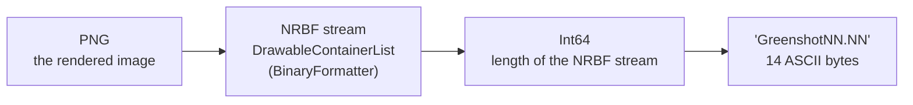
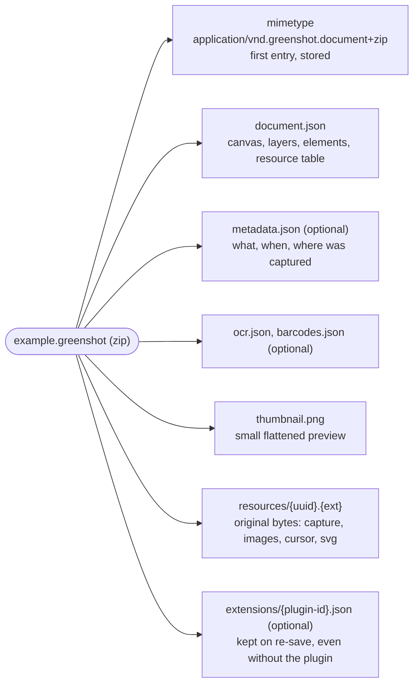
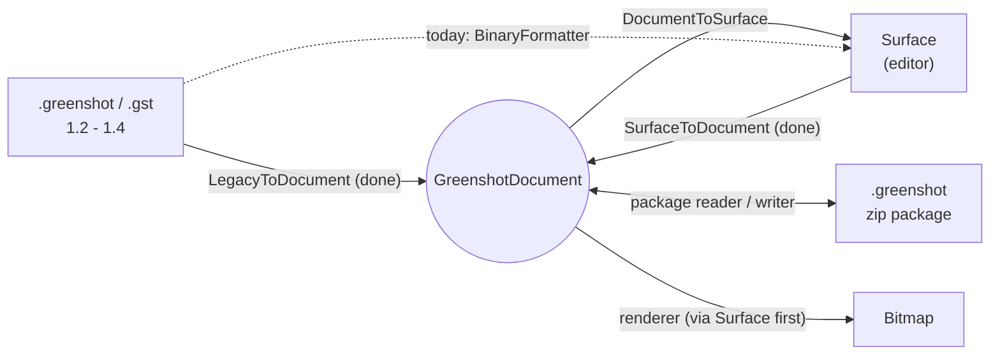

# Greenshot document model and file format

Experimental. The document model runs in parallel with the editor's `Surface` / `DrawableContainer`. It will
replace them step by step, and nothing in a release build uses it yet.

## Why

The editor keeps its content in `Surface` and `DrawableContainer` objects. These need System.Drawing and WinForms,
keep their settings in untyped field bags (`FieldType.LINE_COLOR`, ...), and are saved with BinaryFormatter, which
.NET 9+ no longer has. The `GreenshotDocument` holds the same content as plain data, so that:

- capture, recipes, export and the file format can work without the editor
- the same code runs on .NET Framework 4.8 today and on .NET 10 (and other platforms) later
- a new editor or renderer can be built on it, while the current editor keeps working

## Projects

```mermaid
flowchart BT
    Document["Greenshot.Document<br/>netstandard2.0, no references<br/>model (later: new file format)"]
    Legacy["Greenshot.Document.Legacy<br/>netstandard2.0, System.Formats.Nrbf<br/>.greenshot / .gst of 1.2-1.4 → document"]
    EditorMap["Greenshot.Document.Editor<br/>net48<br/>Surface ⇄ document"]
    Editor["Greenshot.Editor<br/>Surface, DrawableContainer"]
    Base["Greenshot.Base"]
    Tests["Greenshot.Tests"]

    Legacy --> Document
    EditorMap --> Document
    EditorMap --> Editor
    Editor --> Base
    Tests --> EditorMap
    Tests --> Legacy

    classDef planned stroke-dasharray: 5 5
    ```

Arrows point to the referenced project.

- **Greenshot.Document** holds only the model. It targets netstandard2.0, so one binary loads in .NET Framework 4.8 and
  in .NET 10, with no multi-targeting. It has no references, so neither System.Drawing nor Windows code can creep in.
  The new file format (zip + JSON) goes here too, because it is the model's own format.
- **Greenshot.Document.Legacy** reads the BinaryFormatter files of Greenshot 1.2 - 1.4 without BinaryFormatter.
  It is its own project so that the model doesn't carry the NRBF reader or the frozen 1.x schema, and so that legacy
  support can later be removed by deleting one project. If writing 1.3 files is ever wanted, it goes here as well.
- **Greenshot.Document.Editor** is the bridge to the current editor. It maps `Surface` to a document now, and the
  document back to a `Surface` later.
- Only the tests reference these projects. Later, `Greenshot.csproj` references them in Debug builds only, and they
  register through `[assembly: GreenshotModule]`. The installer doesn't list them.

## The model

```mermaid
classDiagram
    direction LR
    class GreenshotDocument {
        Guid Id
        Canvas Canvas
        IReadOnlyList~Layer~ Layers
        IReadOnlyDictionary Resources
    }
    class Canvas {
        int Width
        int Height
        Rgba Background
        int CounterStart
    }
    class Layer {
        Guid Id
        string Name
        LayerKind Kind
        IReadOnlyList~Element~ Elements
        bool Visible
        bool Locked
    }
    class Resource {
        Guid Id
        string MediaType
        byte[] Data
    }
    class Element {
        <<abstract>>
        Guid Id
        ElementStyle Style
        RectD Bounds
    }
    class ElementStyle {
        Stroke Stroke
        Fill Fill
        Shadow Shadow
        TextStyle Text
    }
    GreenshotDocument *-- Canvas
    GreenshotDocument *-- "1..*" Layer
    GreenshotDocument *-- "*" Resource
    Layer *-- "*" Element
    Element *-- ElementStyle
    Element ..> Resource : references by id
```

Rules:

- **Immutable**: all types are records. A change makes a new instance (`element with { Area = ... }`) with the same id.
  Undo can keep earlier documents, since unchanged parts are shared.
- **Order**: `Layers[0]` is drawn first (bottom). Within a layer, `Elements[0]` is drawn first. A layer owns its
  elements, there is no z-index.
- **Coordinates**: canvas pixels as `double`, origin top-left (`PointD`, `RectD`).
- **Colors**: `Rgba`, written as `#RRGGBBAA`.
- **Style**: optional parts. A part that is `null`, or a stroke of width 0, isn't drawn. Text uses its own color
  (for text, speech bubbles and step labels this is today's line color).
- **Resources**: the original bytes with their media type (`image/png`, `image/svg+xml`, `image/x-icon`, ...).
  Elements reference them by id, so the same bytes can be shared.
- **Derived values aren't stored**: the bounds of lines, arrows and freehand lines come from their points, and step
  label numbers come from element order plus `Canvas.CounterStart`.
- A document made from a `Surface` has a locked **Capture** layer with the image and an **Annotations** layer with
  the elements.

### Elements

| Editor container | Element | Data |
|---|---|---|
| `RectangleContainer`, `EllipseContainer` | `RectangleElement`, `EllipseElement` | `Area` |
| `LineContainer`, `ArrowContainer` | `LineElement`, `ArrowElement` | `Start`, `End`, `Heads` (none, start, end, both) |
| `FreehandContainer` | `FreehandElement` | `Points` |
| `TextContainer` | `TextElement` | `Area`, `Text` |
| `SpeechbubbleContainer` | `SpeechBubbleElement` | `Area`, `Text`, `Tail` |
| `StepLabelContainer` | `StepLabelElement` | `Area` (the number is derived) |
| `HighlightContainer` | `HighlightElement` | `Mode` (text, area, grayscale, magnify), `Color`, `Brightness`, `BlurRadius`, `Magnification` |
| `ObfuscateContainer` | `ObfuscateElement` | `Mode` (pixelate, blur), `Size` (pixel size or blur radius) |
| `ImageContainer`, `IconContainer`, `SvgContainer`, `MetafileContainer` | `ImageElement` | `Area`, `Resource`, `Rotation`. Metafiles are stored as PNG, because GDI+ can't write EMF/WMF |
| `EmojiContainer` | `EmojiElement` | `Area`, `Emoji`, `Rotation` |
| `CursorContainer` | `CursorElement` | `Area`, `Resource` (color layer), `MaskResource`, `Hotspot` |
| `CutMarkContainer` | `CutMarkElement` | `Area`, `Horizontal`, `CutStyle`, `Seed`, `ToothHeight`, `ToothRange` |
| `TornEdgeContainer` | `TornEdgeElement` | `Area`, `CutStyle`, `Seed`, `Edges`, `Margins`, `ToothHeight`, `ToothRange` |
| containers of plugins (e.g. the barcode) | `UnknownElement` | `Type` (CLR type name), `Fallback` (resource with a PNG rendering) |
| `CropContainer` | — | a tool, never part of the document |

Effects such as cut marks and torn edges stay elements that can still be edited; they are never baked into the image.

## File formats

### Legacy .greenshot (1.2 - 1.4)



`.gst` templates are only the NRBF stream. The reader walks the NRBF records with `System.Formats.Nrbf`, by type
and member name; it never creates objects by type name. Unknown types become `UnknownElement` instead of failing
the whole file.

### New .greenshot package (planned)

A zip file. The full spec is in the project plan (`greenshot-document-format.md`).



- `document.json` is the model as JSON (System.Text.Json, camelCase). The element type is written as a short name
  (`"type": "arrow"`), never as a CLR type name.
- Readers ignore parts and properties they don't know, and keep unknown elements when they save again.
- Readers have limits: number of entries, uncompressed size, compression ratio, pixels per image, JSON depth.

## Conversions



## Steps

| # | Step | State |
|---|---|---|
| 1 | Model (`Greenshot.Document`) | done |
| 2 | Surface → document (`SurfaceToDocument`) | done |
| 3 | Legacy file → document (`LegacyToDocument`); tested against today's loader via step 2 | done |
| 4 | Document → Surface, and document → bitmap through the Surface | |
| 5 | New file format | |
| 6 | The capture pipeline carries the document next to the Surface | |
| 7 | Recipes add elements to the document | |
| 8 | Renderer without the editor | |
| 9 | Experimental editor UI (optional) | |
| — | Writing 1.3 files | parked (read-only decided) |
