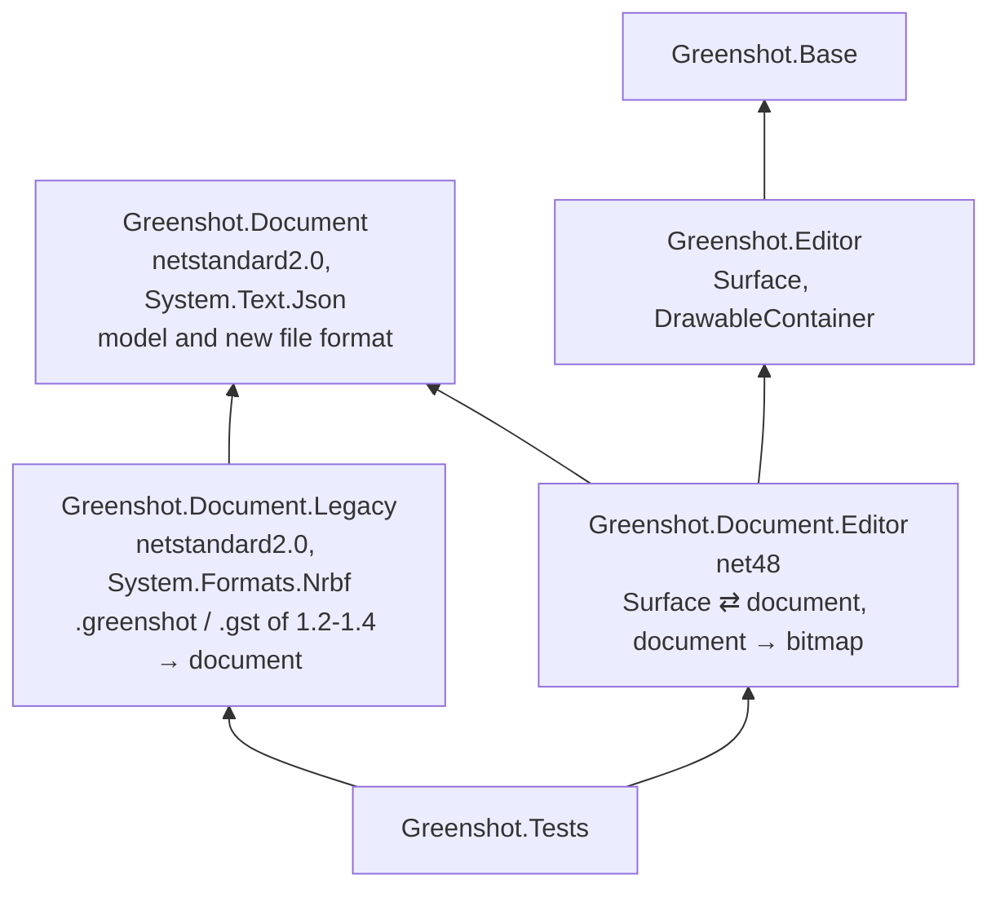
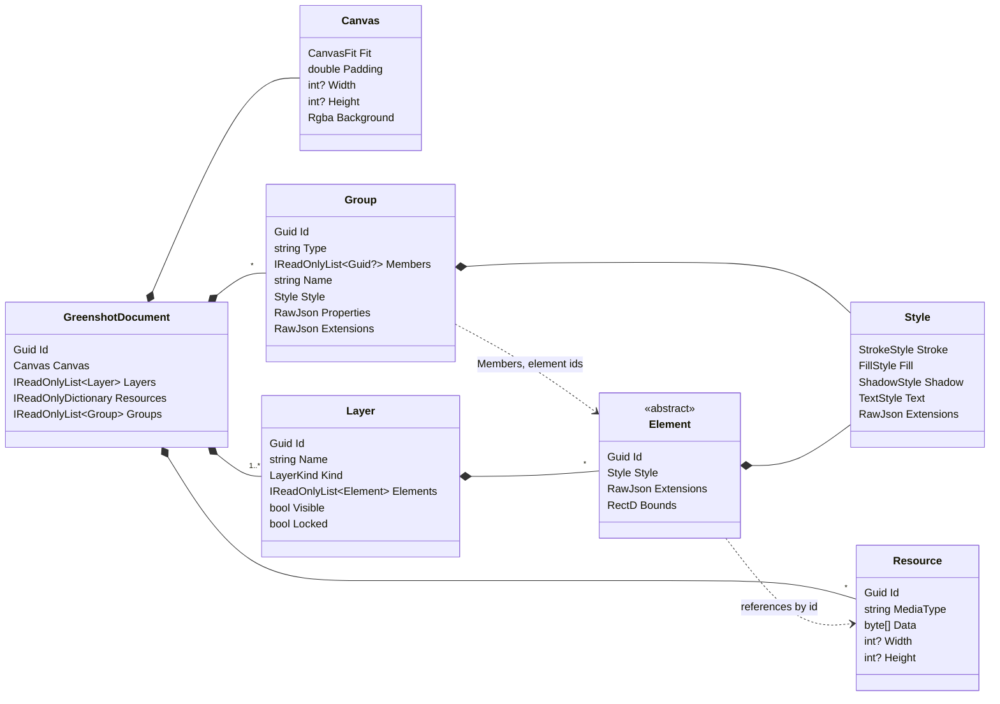
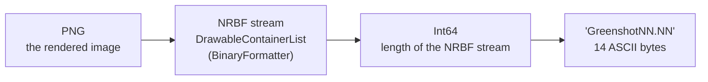
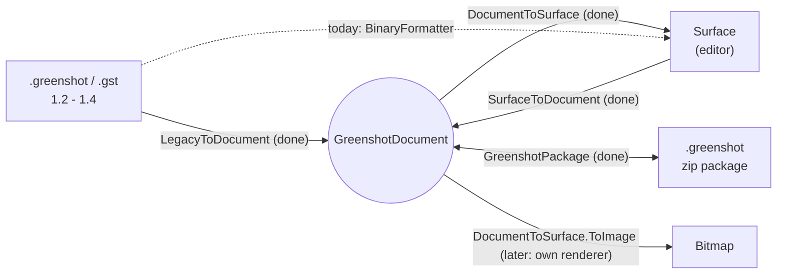

# Greenshot document model and file format

Experimental. The document model runs in parallel with the editor's `Surface` / `DrawableContainer`. It will
replace them step by step, and nothing in a release build uses it yet.

## Why

The editor keeps its content in `Surface` and `DrawableContainer` objects. These need System.Drawing and WinForms,
keep their settings in untyped field bags (`FieldType.LINE_COLOR`, ...), and are saved with BinaryFormatter, which
.NET 9+ no longer has. The `GreenshotDocument` holds the same content as plain data, so that:

- capture, recipes, export and the file format can work without the editor
- the same code runs on .NET Framework 4.8 today and on .NET 10 (and other platforms) later
- a new editor or renderer can be built on it, while the current editor keeps working

## Projects



Arrows point to the referenced project.

- **Greenshot.Document** holds the model and its file format (`GreenshotPackage`, zip + JSON). It targets
  netstandard2.0, so one binary loads in .NET Framework 4.8 and in .NET 10, with no multi-targeting. Its only reference
  is System.Text.Json (part of .NET 10), so neither System.Drawing nor Windows code can creep in.
- **Greenshot.Document.Legacy** reads the BinaryFormatter files of Greenshot 1.2 - 1.4 without BinaryFormatter.
  It is its own project so that the model doesn't carry the NRBF reader or the frozen 1.x schema, and so that legacy
  support can later be removed by deleting one project. If writing 1.3 files is ever wanted, it goes here as well.
- **Greenshot.Document.Editor** is the bridge to the current editor. It maps a `Surface` to a document and back, and
  renders a document to a bitmap through a `Surface` until there is a renderer of its own.
- Only the tests reference these projects. Later, `Greenshot.csproj` references them in Debug builds only, and they
  register through `[assembly: GreenshotModule]`. The installer doesn't list them.

## The model



Rules:

- **Immutable**: all types are records. A change makes a new instance (`element with { Area = ... }`) with the same id.
  Undo can keep earlier documents, since unchanged parts are shared.
- **Order**: `Layers[0]` is drawn first (bottom). Within a layer, `Elements[0]` is drawn first. A layer owns its
  elements, there is no z-index or order field (decided): one source of truth, no duplicates or gaps, and "bring to
  front" is moving within the list. Recipes place an element with a command ("to front", "above an element") when they
  add it. An optional `z` can come later if edits from several places ever have to be merged; readers which ignore it
  still have the list order. Numbering order is separate from drawing order: it is the member order of a steps group
  (see "Groups, styles and defaults"), so moving an element up or down never renumbers.
- **Ids**: new ids are UUID version 7 (`Uuid7.CreateVersion7`, replaced by `Guid.CreateVersion7` on .NET 10). They
  start with the creation time, so `Uuid7.TryGetTimestamp` gives the date a document, element or resource was created.
  Ids are kept on read and write; ids from elsewhere (e.g. `Surface.ID`) can be any version.
- **Coordinates**: canvas pixels as `double`, origin top-left (`PointD`, `RectD`). The capture normally is at 0, 0;
  the canvas is a rule (see "Canvas"), so an element left of the capture has a negative x and nothing moves when the
  canvas changes.
- **Colors**: `Rgba`, written as `#RRGGBBAA`.
- **Style**: every part and value is optional and inherited when it isn't set, see "Groups, styles and defaults".
  Text uses its own color (for text, speech bubbles and step labels this is today's line color).
- **Visibility** (decided): only layers have it. A hidden layer isn't drawn in exports, but it stays in the saved
  file. Groups have no visibility ("hide all in this group" is an editor command), elements have none for now (see
  "Groups, styles and defaults").
- **Redaction**: a `.greenshot` file always contains the original capture, blur and pixelate are elements on top. A
  redaction is only safe in a flattened export (PNG, JPG, ...), never in the `.greenshot` file. The same is true for 1.3.
  The same goes for an image element with a `source`: the part outside of it is still in the resource, so a crop done
  that way only removes pixels in a flattened export.
- **Resources**: the original bytes with their media type (`image/png`, `image/jpeg`, `image/webp`, `image/svg+xml`, ...).
  An image loaded from a file keeps that file, in every format a file format handler reads; only an image which
  didn't come from a file (or was changed) is stored as PNG. Elements reference them by id, so the same bytes can be shared.
- **Derived values aren't stored**: the bounds of lines, arrows and freehand lines come from their points, and step
  label numbers come from their place in their series.
- A document made from a `Surface` has a locked **Capture** layer with the image and an **Annotations** layer with
  the elements.

### Elements

| Editor container | Element | Data |
|---|---|---|
| `RectangleContainer`, `EllipseContainer` | `RectangleElement`, `EllipseElement` | `Area` |
| `LineContainer`, `ArrowContainer` | `LineElement`, `ArrowElement` | `Start`, `End`, `Heads` (none, start, end, both) |
| `FreehandContainer` | `FreehandElement` | `Points` |
| `TextContainer` | `TextElement` | `Area`, `Text` |
| `SpeechbubbleContainer` | `SpeechBubbleElement` | `Area`, `Text`, `Tail` |
| `StepLabelContainer` | `StepLabelElement` | `Area` (the number is derived) |
| `HighlightContainer` | `HighlightElement` | `Mode` (text, area, grayscale, magnify), `Color`, `Brightness`, `BlurRadius`, `Magnification` |
| `ObfuscateContainer` | `ObfuscateElement` | `Mode` (pixelate, blur), `Size` (pixel size or blur radius) |
| `ImageContainer`, `IconContainer`, `SvgContainer`, `MetafileContainer` | `ImageElement` | `Area`, `Resource`, `Rotation`, `Source`, `Scaling` (see "Images" below). Metafiles keep the EMF/WMF file they were loaded from (`image/emf`, `image/wmf`); a metafile from an old .greenshot file is only a PNG there |
| `EmojiContainer` | `EmojiElement` | `Area`, `Emoji`, `Rotation` |
| `CursorContainer` | `CursorElement` | `Area`, `Resource` (color layer), `MaskResource`, `Hotspot` (the tip as a fraction 0..1 of `Area`, so it stays right when the cursor is resized) |
| `CutMarkContainer` | `CutMarkElement` | `Area`, `Horizontal`, `CutStyle`, `Seed`, `ToothHeight`, `ToothRange` |
| `TornEdgeContainer` | `TornEdgeElement` | `Area`, `CutStyle`, `Seed`, `Edges`, `Margins`, `ToothHeight`, `ToothRange` |
| containers of plugins (e.g. the barcode) | `PluginElement` | `Area`, `Kind`, `Version`, `Data` (JSON), `Resources`, `Fallback` (see below) |
| — | `UnknownElement` | an element of a type this version doesn't know (e.g. from a newer Greenshot): `TypeName`, `Area`, `Json` |
| `CropContainer` | — | a tool, never part of the document |

Effects such as cut marks and torn edges stay elements that can still be edited; they are never baked into the image.

### Plugin elements

The core doesn't know the elements of plugins, it has one generic `PluginElement` for all of them:

- `Kind`: a stable name the plugin owns, e.g. `greenshot.barcode`, never a CLR type name. Nothing in a file says which
  class to create.
- `Version` and `Data`: the plugin's own data as JSON, in the version of the plugin; only the plugin reads it.
- `Resources`: the resources the data links to, so writing keeps them.
- `Fallback`: a PNG rendering of the element, so it can be shown and exported without the plugin.

A plugin registers an `IPluginElementConverter` (SimpleServiceProvider) for its `Kind`: container to element and back.
Without the plugin, or when the element has a newer `Version` than the plugin reads, the `Surface` shows the fallback
image; it can be moved, resized or deleted, and is written back unchanged (with its new area). A plugin container
without a converter becomes a `PluginElement` with the CLR type name as `Kind`, only the fallback and no data.

An element of an unknown type (`UnknownElement`) keeps its JSON as it was read and is written back unchanged, with
the resources it links to. The `Surface` can't show it; it is kept with the surface and added at the end of the
annotations when the surface becomes a document again.

Plugin elements of old .greenshot files only have the CLR type name: their data can't be read without the plugin's
types, so they become a `PluginElement` without data or fallback.

### Geometry: Area and Bounds

All coordinates are canvas pixels (`double`), origin top-left, x to the right, y down.

- **`Area`** (stored): the rectangle of a box-shaped element, **before rotation**: `x`, `y` (top-left), `width`,
  `height`. It is what the user draws and edits. Box-shaped are rectangle, ellipse, text, speech bubble, step label,
  highlight, obfuscate, image, emoji, cursor, cut mark, torn edge, plugin and unknown elements. In `document.json` it is
  `"area": {"x": 10, "y": 20, "width": 100, "height": 50}`.
- **Points** (stored): elements defined by points store those instead of an `Area`: `start` and `end` for lines and
  arrows, `points` for freehand, and the `tail` of a speech bubble (next to its `Area`).
- **`Bounds`** (calculated, never stored): the smallest axis-aligned rectangle around the shape of the element, after
  rotation and including points like the tail, without stroke width or shadow. Every element has it. It is used for
  what needs one box per element: the edges an anchor refers to when the target is a line or freehand, the selection
  frame, finding the element under the mouse (first test), which part of the canvas to redraw, "fit the canvas to the
  content", and the box of a group. The tail of a speech bubble is included; the rotation of images and emojis isn't
  yet (its rule is still a proposal, see below).

### Images

An `ImageElement` shows its resource in its `Area`. Resizing only changes the `Area`, the resource is never resampled
and stored again.

- **`source`**: the part of the resource that is shown, stretched into `Area`, as a fraction (0..1) of the resource's
  width and height, so the document doesn't have to decode the image to know its size and it also works for SVG and
  metafiles. Missing means the whole image. Rotation is applied after the part is fitted into `Area`.
- **Shared resources**: several image elements can use the same resource with different parts, e.g. a zoom inset next
  to the capture showing a detail of it larger. The bytes are stored once.
- **Crop that keeps the original**: a crop of an image changes its `source` and `Area`, so it can be widened again
  later. The pixels outside of `source` stay in the file, see the redaction rule.
- **`scaling`**: how the image is drawn when its size differs from `source`: `smooth` (bilinear or bicubic, the
  default) or `pixelated` (nearest neighbour, text and lines of 1 px stay crisp when zoomed). Each renderer maps it to
  its own modes.
- **`scale`**: shows the image at a factor of the size of the part it shows (`0.5` is half the size), so another
  screenshot in its place keeps it. Like an anchor it is a rule: `Area` is still written as the result, and resizing in
  the editor removes it. It needs the size of the resource, which the resource table has (`width`, `height`; read from
  the header of a PNG when it's missing).
- **Today's editor** (Surface): the `ImageContainer` draws the `source` part of a bitmap with its `scaling`. A rotated
  bitmap is turned in its pixels there, so its part is cut out before and the trip back has no `source`. SVG, icons
  and metafiles are shown whole, their `source` and `scaling` are kept through the trip.

### Canvas

The canvas is the area which is drawn and exported. It is a rule, not a stored size:

| `fit` | the canvas is | stored |
|---|---|---|
| `capture` (default) | the Bounds of the capture image (the first image of a capture layer), plus `padding` | `padding` |
| `content` | the union of the Bounds of all elements of visible layers, plus `padding` | `padding` |
| `fixed` | `width` x `height` from 0, 0 | `width`, `height` |

`GreenshotDocument.CanvasArea()` works it out (after `Anchors.Apply`, so anchored elements are where they belong).
`background` fills what no element covers, transparent by default (`#00000000`); an export to a format without alpha
(JPG, BMP) needs a fill colour. On a `fixed` canvas elements can be anchored to it with `"target": "canvas"`, e.g. to
centre the capture; the other canvases depend on the elements, so there `canvas` is no target.

A screenshot at half size with a footer centred below it, on white with 20 px around both:

```json
"canvas": { "fit": "content", "padding": 20, "background": "#FFFFFFFF" },
"layers": [
  { "id": "…", "name": "Capture", "kind": "capture", "locked": true, "elements": [
    { "type": "image", "id": "…", "resource": "<id>", "scale": 0.5, "area": { "x": 0, "y": 0, "width": 960, "height": 540 } } ] },
  { "id": "…", "name": "Footer", "kind": "custom", "elements": [
    { "type": "text", "id": "…", "text": "Figure 1", "area": { "x": 280, "y": 550, "width": 400, "height": 30 },
      "anchor": { "x": { "target": "center", "self": "center" }, "y": { "target": "end", "self": "start", "offset": 10 } } } ] }
],
"resources": { "<id>": { "path": "resources/<id>.png", "mediaType": "image/png", "width": 1920, "height": 1080 } }
```

Today's editor (Surface) has no canvas of its own, its image is the canvas. When the capture doesn't simply fill the
canvas, the editor gets the capture layers drawn onto the canvas and the elements moved by the start of the canvas; as
long as the editor keeps that image, the capture layers, the canvas and the coordinates come back unchanged. An effect
which changes the image (border, crop, resize) bakes the canvas into a new capture at 0, 0.

### Text

The `text` part of a style:

- `family`: font families separated by commas, the first which is available is used, e.g.
  `"Segoe UI, Arial, sans-serif"`. It can end with a generic family: `sans-serif`, `serif` or `monospace`. Segoe UI
  doesn't exist on Linux or macOS, so a list keeps documents portable.
- `size` in canvas pixels, not points (the editor creates its fonts with `GraphicsUnit.Pixel`).
- `weight` 100 - 900 (400 normal, 700 bold), `italic`, `underline`, `strikeout`, `color`.
- `horizontal`, `vertical`: `near`, `center`, `far`.
- `lineHeight`: the distance of lines as a multiple of the size, without it the font decides.
- `wrap`: text which is too long for its `Area` continues on the next line.
- `outline`: a stroke around each letter (`color`, `width`), so text on a screenshot is readable on any background.

Today's editor uses the first installed family, bold for a weight from 600 and none of underline, strikeout, line
height, wrap and outline; the list and these values are kept through a trip through the editor.

Fonts aren't embedded. A font can be used without installing it (GDI+ `PrivateFontCollection`, WPF and SkiaSharp
load fonts from a stream), but most font licences, those of the Windows fonts too, don't allow passing them on; a
font would only be embedded when the user asks and its licence (`fsType` in the font) allows it.

### Design proposals (not decided)

- **Rotation**: one rule for all box-shaped elements: `rotation` in degrees (a `double`), clockwise, around the centre of the
  `Area`; the `Area` stays unrotated. Today only images and emojis have it. Elements defined by points don't need it,
  rotating them changes their points.
- **Styles beyond the current set**: an element's style has optional parts (stroke, fill, shadow, text). A new kind
  of style becomes a new optional part, readers which don't know it ignore it and still draw the rest. So a document
  written by a newer Greenshot doesn't lose them on save, unknown properties of a style (and of an element) are kept
  and written back unchanged. Style settings only one plugin understands go in the plugin element's data, or under a key with the plugin's name
  (`"zxing.quietZone"`) so they never collide with core names. Shared styles: decided, see "Groups, styles and defaults".
- **Speech bubble tail with anchors**: decided, see "What is anchored": the text box and the tail have their own
  anchors. The same anchors on `start` and `end` turn a line or arrow into a connector between two elements.
- **Text in elements**: not through anchors. An anchor only positions; text inside a rectangle must also wrap and
  resize with it. Instead, rectangles, ellipses and lines get an optional `text`, drawn inside the `Area` and rotated with it (on a line at
  `labelPosition`, 0 to 1 from start to end, default 0.5) with the text style that already exists. A speech bubble is then a rectangle with a text and a tail.
- **Grouping**: decided, see "Groups, styles and defaults" (the `set` type).

### Groups, styles and defaults

Built in the model: groups with members, the steps numbering (`StepNumbering`, `GreenshotDocument.LabelOf`), the
`Style` type with merging (`GreenshotDocument.StyleOf`, `StyleDefaults`), extensions and the write gate. Not built yet,
they come with an editor which knows groups: joining and leaving, the checks on joining, what a `set` does.

One concept for everything that belongs together: step label numbering, shared styles and PowerPoint-like grouping.

```json
"groups": [
  { "id": "…", "type": "steps", "name": "Steps", "properties": { "start": 1, "format": "numbers" },
    "style": { "fill": { "color": "#0000FFFF" } }, "members": ["<a>", null, "<c>"] },
  { "id": "…", "type": "style", "name": "Red marker", "style": { "stroke": { "color": "#FF0000FF", "width": 3 } },
    "members": ["<arrow>"] },
  { "id": "…", "type": "set", "name": "Callout 1", "members": ["<rectangle>", "<arrow>"] },
  { "id": "…", "type": "zxing.barcodes", "properties": { }, "extensions": { }, "members": [] }
]
```

- **A group** has an id, a `type`, an optional `name`, `style`, `properties` (defined by the type), `extensions` and
  its `members` (element ids). The document has a list of groups next to its layers. Elements don't mention their
  groups in the file; the model builds the lookup element → groups when it reads the document.
- **Members**: an element can be in several groups, and members can be in different layers. An element is in at most
  one `steps` group and at most one group with a style, checked when it joins (this can be relaxed later, the reverse
  would break documents). No groups inside groups for now. Writing is the gate, as for resources: member ids which no
  longer exist are dropped (an empty group can go too).
- **Types** decide the behaviour:

  | type | style for its members | numbering | selected / moved together |
  |---|---|---|---|
  | `steps` | optional | yes | no |
  | `style` | yes | no | no |
  | `set` | optional | no | yes (selected, moved, copied, deleted as one) |
  | a plugin type | defined by the plugin | | |

  In the UI they are named by what they do ("Numbering", "Style", "Group"). A group of an unknown type (a plugin which
  isn't installed, a newer Greenshot) is kept and written back unchanged; its members behave as in no group. Unknown
  properties of a known type are kept too.
- **Steps**: `properties` has `start` (the counter start, which is not on the canvas) and `format` (`numbers`,
  `lowerLetters` a..z aa, `upperLetters`, `lowerRoman`, `upperRoman`). The member order is the numbering order: the
  entry at place n (from 0) shows `start + n`. A `null` entry skips a number (`[a, null, c]` gives 1 and 3) and is kept
  on write. Deleting a step label removes it from the list (the following numbers move up, as today); "delete, keep the
  number" leaves a `null`. A step label in no steps group is numbered 1, 2, 3 in drawing order. The legacy reader makes
  one steps group of all labels, in the order of their stored number, with the stored counter start.
- **Layers stay separate**: a layer contains its elements, each element is in exactly one layer, and the layer's list
  is the drawing order. Groups are memberships on top of that. In code both can share a small base (id, name,
  extensions).

**Style.** One `Style` type, the same on an element and on a group, with the parts `stroke`, `fill`, `shadow` and
`text` and `extensions`. Every value is optional: a value which isn't written is inherited, a written value is that
value. Only a whole part can be switched off, with `enabled: false` (e.g. `"fill": { "enabled": false }` means no fill,
even when the group has one); single values (width, size, colour, alignment) never need "off". In code every value is
nullable, `null` means "not set here", a JSON `null` is the same as a missing value.

- **Merging**, value by value, bottom to top: built-in default for the element type → the style of its group →
  the element's own style. A resolver gives the full style to draw with, renderers never see the partial one.
  Example: the group has a red stroke of 3 px, an arrow in it sets only `"stroke": { "width": 5 }`: it is drawn red,
  5 px; when the group turns blue, the arrow turns blue and stays 5 px.
- **Joining a group**: the element takes the group's look: its own values for what the group's style sets are
  removed. Changes afterwards are overrides on that element; "Reset to group style" removes them.
- **Leaving a group** (or the group is deleted): the element keeps its look, the values it inherited are copied into
  its own style.
- **Changing the group's style**: every member follows, except for the values it overrides.
- **An element in no group** has its full style itself, as today and as files of 1.2 - 1.4 are read.

**Defaults per element type.**

- **Built-in defaults** (e.g. a step label's fill, an arrow's 2 px red stroke) are fixed in the model's code and
  documented per format version, so a file looks the same on every machine and in every later Greenshot. Changing one
  means a new format version whose reader writes the old value into older files.
- **The user's last-used values** (`LastUsedFieldValues` in greenshot.ini, one per tool and value, see
  `EditorConfigurationHelper.CreateField`) are only used when an element is created, and written into it. A document
  never depends on someone's settings.
- **Document defaults per type** ("every arrow in this capture is blue", a recipe making all step labels green) can
  later be a style group with an "applies to type" property, not a separate table. Merging is then: built-in default
  → groups which apply to the type → the element's group → the element. Plugin types the same way under their kind.
  Not until a recipe or the editor needs it.

**Visibility of elements**: not for now. A forgotten hidden blur or pixelate would uncover what it covers in an export;
a small layer does the same job and stays visible in the layer list. If it comes later: an optional `visible`
(missing = visible), drawn = layer visible and element visible, with a warning on export when a hidden element is a
redaction. Older files are not affected.

### Anchors

Built in the model: `Anchor` and `AxisAnchor` on the parts below, `Anchors.Apply` (places every anchored part),
`Anchors.MakesLoop` (the check when an anchor is set) and the loop check when a document is written. The "Add Elements"
recipe step places its elements with them (`DocumentToSurface.Place`, relative to the capture and to each other).
Today's editor keeps the anchors of an element (and its extensions and the groups of the document) through a trip, but
doesn't apply them again when something moves; the dragging rules below come with an editor which knows anchors.

An element can be anchored to another element, the target. Without a target it is anchored to the capture image, so
elements follow the capture when the canvas grows (e.g. a border) or the capture moves.

- **What is anchored**: the parts of an element that have a position, each on its own. A box-shaped element has an
  anchor for its `Area`. Lines and arrows have one for `start` and one for `end`, so each end can follow a different
  element (or none). A speech bubble has one for its `Area` (the text box) and one for its `tail`, so it can point at
  something while the box sits beside the capture. Freehand has one for all its points together.
- **Shape**: `anchor` on the element (its `Area`; all points of lines, arrows and freehand), `startAnchor` and
  `endAnchor` on lines and arrows, `tailAnchor` on a speech bubble. Each has `target` (an element id, missing = the
  capture image, the first image of the capture layer) and per axis `x`, `y`: a line on the target (`start`, `center`,
  `end` of its `Bounds`, or `point`), a line on the element itself (`self`, for points not used) and an `offset` in
  pixels. An axis without an entry isn't anchored, except that a point anchor (`startAnchor`, `endAnchor`, `tailAnchor`)
  without any axis uses `point` on both. A speech bubble is placed by its text box and its tail moves with it, unless the tail has its own anchor.
  `{"anchor": {"x": {"target": "end", "self": "end", "offset": -10}}}`
  - Inside the target, 10 px from its right edge: x target `end`, self `end`, offset -10.
  - Outside, a caption below the target: y target `end`, self `start`, offset 8.
  - Centred on the target: target `center`, self `center`.
  - An arrow pointing at the tip of the mouse cursor: `{"endAnchor": {"target": "<id of the cursor>"}}`.
- **Anchor point**: `point` is the calculated `AnchorPoint` of the target (document, never stored): the tip of a cursor,
  the end of a line or arrow, the tail of a speech bubble, otherwise the centre of `Bounds`. Each axis picks its own
  line, so x can follow the tip of a cursor while y follows the bottom of its box.
- **The position stays absolute**: the element keeps its normal position and size; the anchor is only the rule to apply
  again when the target moves or changes size. A reader which ignores anchors still draws everything in place.
- **When**: anchors are applied again when the target's bounds change (moved, resized, cropped, canvas grown). They use
  the calculated `Bounds` of the target and move the element by shifting what it stores (`Area`, or the points of
  lines and freehand), so they work for every element type.
- **Resolving**: to place an element, first place its target: follow the targets up the chain to an element without
  anchor, then come back down and apply each anchor in turn. Every element is placed once.
- **Loops**: setting an anchor which would make a loop (A to B, B to A, or longer) is refused when the anchor is set,
  and checked again when the document is written.
- **Deleted target**: the anchor is removed, the element stays where it is. Until then a target which doesn't exist
  leaves the part where it is.
- **Dragging** (agreed): the anchor stays and only its offset changes, the element lands where it is dropped. A free
  axis just moves. Resizing: moving the anchored edge changes the offset, resizing from the other side doesn't. On drop
  the anchor switches to the nearest line of the target (start, center, end) and the offset is recalculated, nothing
  visible changes. Dragging the target moves everything anchored to it. While dragging, a thin line shows the edge the
  element is anchored to. Changing or removing an anchor is always deliberate ("Anchor to…", "Detach" in the context
  menu); only the end of a line or arrow, or the tail of a bubble, dropped onto a highlighted element anchors to it.
  The move and the anchor change are one undo step.
- **Recipes**: the "Add Elements" step takes the same anchor; its elements can be anchored to the capture and to each
  other. The anchor, margin and offset parameters of the annotation step can map onto it.
- **Ids**: the capture image element and the layers keep their ids through the editor, also for a surface which didn't
  come from a document (it gets them once).

## File formats

### Legacy .greenshot (1.2 - 1.4)



`.gst` templates are only the NRBF stream. The reader walks the NRBF records with `System.Formats.Nrbf`, by type
and member name; it never creates objects by type name. Unknown types become a `PluginElement` with the type name
instead of failing the whole file.

### New .greenshot package

A zip file, read and written by `GreenshotPackage`. The full spec is in the project plan (`greenshot-document-format.md`);
so far the package has `mimetype`, `document.json` and `resources/`, the other parts follow.


- `document.json` is the model as JSON (System.Text.Json, camelCase) with a `version` (now 1); newer versions are
  refused. The element type is written as a short name (`"type": "arrow"`), never as a CLR type name. Enums are
  camelCase names, colors `#RRGGBBAA`, derived values (bounds, the canvas area) aren't written, nor are values which
  are the default (`scaling`, `rotation`, an empty `style`, an `offset` of 0, `locked` false). The resource table maps
  each resource id to its path, media type and size in pixels, the bytes are in `resources/{id}.{ext}`.
- Writing is the gate for resources: only resources an element links to are written, a link to a missing resource
  or a media type the file format registry doesn't know (it gives the `{ext}`) is refused. A resource can be linked
  more than once; an action which changes an image (e.g. crop) either keeps the original and stores the operation,
  or adds a new resource in a format the registry supports.
- Readers ignore properties they don't know. An element with an unknown `type` becomes an `UnknownElement`, which is
  written back unchanged.
- Readers have limits: number of entries (10,000) and size per entry (256 MB).
- Open: the optional parts.

## Conversions



## Steps

| # | Step | State |
|---|---|---|
| 1 | Model (`Greenshot.Document`) | done |
| 2 | Surface → document (`SurfaceToDocument`) | done |
| 3 | Legacy file → document (`LegacyToDocument`); tested against today's loader via step 2 | done |
| 4 | Document → Surface, and document → bitmap through the Surface (`DocumentToSurface`) | done |
| 5 | New file format (`GreenshotPackage`): document.json and resources | done |
| 6 | The capture pipeline carries the document next to the Surface | |
| 7 | Recipes add elements to the document | |
| 8 | Renderer without the editor | |
| 9 | Experimental editor UI (optional) | |
| — | Writing 1.3 files | parked (read-only decided) |

## Not in the model yet

- The shadow settings of cut marks and torn edges (darkness, size, offset): they come from the torn edge settings when
  a document becomes a `Surface`.
- Only Windows can draw EMF/WMF; other platforms will need a PNG rendering next to the metafile.
- The editor has one counter and no groups. A document becomes a `Surface` with each element's resolved style and the
  first steps group (its start, its label order); back from the `Surface` there is one steps group (the other steps
  groups are merged into it), the other groups are kept, and every element has its full style. Hidden layers don't
  reach the `Surface` yet.
- No plugin has an `IPluginElementConverter` yet (the barcode would be the first); until then a plugin's element is kept
  with only its fallback.
