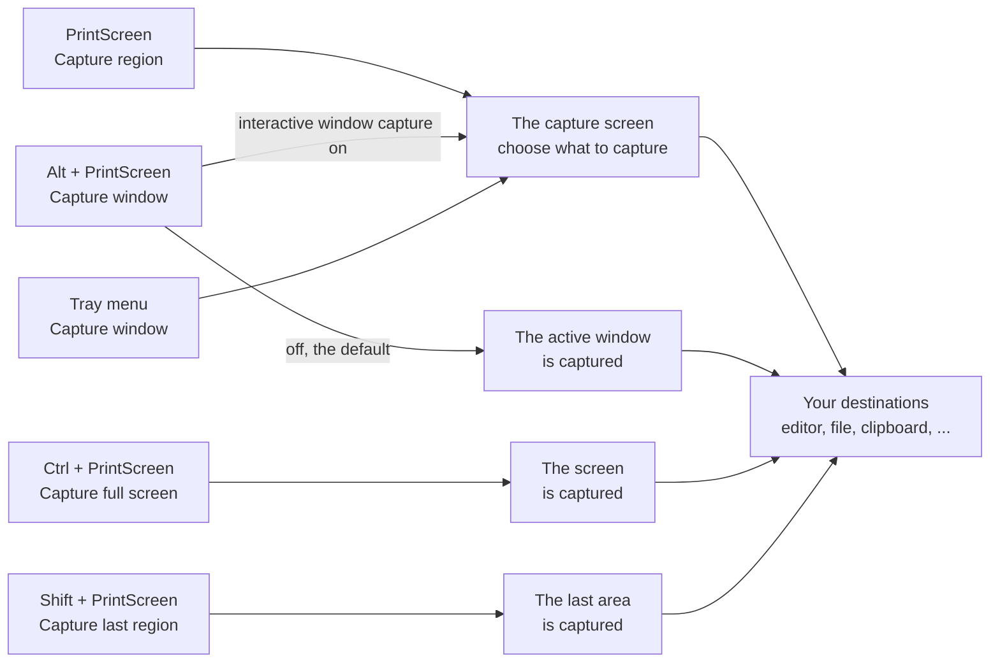
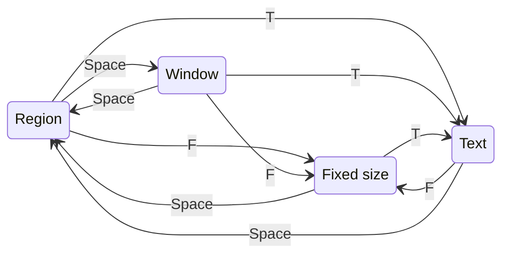
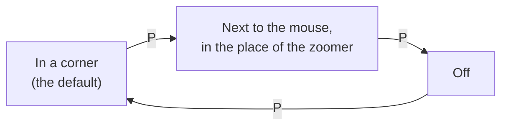
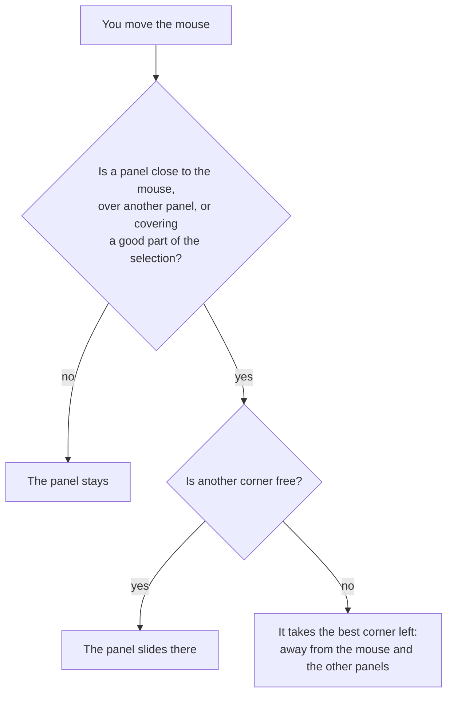

# Capturing with Greenshot 1.4

This describes Greenshot 1.4, which is still in development. For Greenshot 1.3, the current release, see [the 1.3 guide](../capture-user-guide.md).

This guide explains what happens when you take a screenshot with Greenshot: the ways to start a capture, the modes you can
choose from while you select (region, window, fixed size and text), the helpers on the screen (zoomer, keys, info and preview),
every key, what Greenshot remembers for the next time, and the settings which change how capturing works.

- [Starting a capture](#starting-a-capture)
- [The capture screen](#the-capture-screen)
- [The modes](#the-modes)
  - [Region](#region)
  - [Window](#window)
  - [Fixed size](#fixed-size)
  - [Text](#text)
- [The helpers](#the-helpers)
  - [Zoomer](#zoomer)
  - [Keys (help)](#keys-help)
  - [Info](#info)
  - [Preview of the selection](#preview-of-the-selection)
  - [Crosshair and size labels](#crosshair-and-size-labels)
  - [QR codes](#qr-codes)
- [Why the panels and the zoomer move](#why-the-panels-and-the-zoomer-move)
- [All keys](#all-keys)
- [What Greenshot remembers](#what-greenshot-remembers)
- [Settings which change capturing](#settings-which-change-capturing)
- [Good to know](#good-to-know)

## Starting a capture

| Capture | Default hotkey | What happens |
|---|---|---|
| Capture region | `PrintScreen` | The capture screen opens in the region mode. |
| Capture window | `Alt` + `PrintScreen` | Captures the active window right away. With *Use interactive window capture mode* turned on (Settings, Capture tab) the capture screen opens in the window mode instead. |
| Capture full screen | `Ctrl` + `PrintScreen` | Captures the screen right away, without the capture screen. |
| Capture last region | `Shift` + `PrintScreen` | Captures the same area as your last capture again, without the capture screen. |
| Open image from clipboard | none | Opens the image on the clipboard. |

The same captures are in the menu of the Greenshot icon next to the clock. There, *Capture window* always opens the capture screen
in the window mode. With more than one monitor, *Capture full screen* has a sub menu: *all* monitors, or one of them.
*Capture window from list* lists the open windows and captures the one you pick, without the capture screen.

You can change the hotkeys in the settings, on the General tab.



## The capture screen

Greenshot takes a picture of all your monitors first, then shows it on top of everything. What you see is a frozen picture:
nothing on the screen changes while you select, so a tooltip or an open menu stays where it was.
You choose what to capture in this picture, and only that part is used.
To select on the live screen instead, see [Without freezing the screen](#without-freezing-the-screen).

On top of the picture you see:

- the **selection**, the frame of what will be captured, with its size,
- the **zoomer**, a magnifier next to the mouse,
- **panels** in the corners: the keys (help), the info and the preview of the selection, and the list of sizes in the fixed size mode.

An example of how it can look, while a region is selected (the places change, see [Why the panels and the zoomer move](#why-the-panels-and-the-zoomer-move)):

```
┌────────────────────────────────────────────────────────────────────────┐
│ ┌─────────────────────────┐                     ┌────────────────────┐ │
│ │ Keys                    │                     │ Info               │ │
│ │ Enter  Start or finish… │                     │ Screen  2560 × 1440│ │
│ │ ↑↓←→   Move the cursor… │                     │ Selection 640 × 480│ │
│ │ ...                     │                     │ Window  Notepad    │ │
│ └─────────────────────────┘                     │ Mouse   1100, 820  │ │
│                                                 └────────────────────┘ │
│              ├──────────── 640 ────────────┤                           │
│           ┬  ┌─────────────────────────────┐                           │
│           │  │                             │                           │
│          480 │          640 x 480          │                           │
│           │  │                             │                           │
│           ┴  └─────────────────────────────┼  ╭──────────╮             │
│                                               │  zoomer  │             │
│ ┌──────────────────┐                          │    ┼     │             │
│ │ ░░░░ preview ░░░ │                          ╰──────────╯             │
│ │ 640 × 480   42 % │                                                   │
│ └──────────────────┘                                                   │
└────────────────────────────────────────────────────────────────────────┘
```

`Esc` closes the capture screen without capturing anything. Clicking or pressing `Enter` (depending on the mode) captures the
selection, and Greenshot sends it to your destinations (the editor, a file, the clipboard, ...) as it always does.

### Without freezing the screen

Turn off *Freeze the screen while selecting* on the Capture tab of the settings, and the capture screen is see-through: what is on
the screen keeps moving while you select, a video keeps playing. Greenshot takes no picture first, so the capture screen appears
at once, and only what you selected is captured, at the moment you release the mouse (or press `Enter`). Bright HDR content
looks the same while you select as on the screen.

Press `L` while selecting to switch between the frozen picture and the live screen, the setting only decides how the capture
screen starts. Switching to the live screen throws the picture away, switching back takes a new picture of the screen as it is
then. Your selection stays.

The selection, snapping to windows, the keys, the zoomer and the panels work as with the frozen picture. The differences:

- **The moment of the capture** is when you finish the selection, not when you started the capture.
- **The program below keeps the focus**, so it looks active in the capture. Your keys go to the capture screen until it closes.
- **Open menus and tooltips** usually close when you click, use the frozen screen (the default) for them.
- **No text mode and no QR codes:** both need the picture of the screen. *Capture text* (OCR) and recipes which select text
  always start frozen, `T` on the live screen freezes it first. QR codes are only found on the picture the capture started with.
  AI tools always freeze the screen, `L` doesn't work for them.
- **No preview of the selection**, there is no picture to show it from.
- Needs Windows 10 version 2004 or newer, older Windows versions always freeze the screen and have no `L`.

## The modes

The capture screen has four modes. One of them is active at a time, and you can switch between them at any moment with a key.
A capture started with *Capture region* begins in the region mode, one started with *Capture window* in the window mode.



- `Space` switches between region and window; from the fixed size or the text mode it goes back to region.
- `F` switches to the fixed size mode, `T` to the text mode, from every mode.

| Mode | You select | You capture with | Zoomer | Crosshair |
|---|---|---|---|---|
| Region | a rectangle, by dragging | releasing the mouse, or `Enter` twice | yes | yes, until you start dragging |
| Window | the window (or a part of it) under the mouse | a click or `Enter` | no | no |
| Fixed size | a rectangle of a chosen size, which follows the mouse | a click or `Enter` | yes | no |
| Text | lines or words of text found on the screen | a click on a line, or dragging over words | yes | yes, until you start dragging |

### Region

Drag a rectangle with the mouse: press the left mouse button where it should start, move to where it should end, and let go.
That captures the rectangle. The size shown is exactly the size of the capture: the pixel under the mouse belongs to it.

You can also do it all with the keyboard: move the mouse with the arrow keys, press `Enter` to start, move to the other corner,
and press `Enter` again to capture.

- **Arrow keys** move the mouse one pixel, **`Ctrl` + arrow keys** ten pixels. Together with the zoomer this places a corner exactly.
- **Hold `Shift`** while dragging to keep the selection to one direction: the first move after pressing `Shift` decides whether only
  the width or only the height changes. Let go of `Shift` to change both again.
- A very small drag of a few pixels counts as a click and captures nothing, so you can just try again.

### Window

The selection follows the window under the mouse: it slides from window to window as you move. Click, or press `Enter`, to capture it.
Without a mouse, `Tab` selects the next window (the top one first) and `Shift` + `Tab` the previous one.

- Greenshot selects the innermost window under the mouse, e.g. a panel or a toolbar inside a program, when the program is built from
  several windows. Move to the outer edge of a program window to select the whole window.
- Only the visible part of a window is captured: a part which lies outside of its program window, or outside of the screens, is left out.
- The windows are those of the moment the picture was taken.
- `D` shows or hides technical details of the selected window next to the size: its number, its title (or the name of the program),
  and for an area its type and name. This helps when you report a problem with a certain program.

**For beta testers** (Expert settings, *Enable to enable beta-test features*): many programs draw their whole content themselves,
e.g. web browsers, so Greenshot only finds one window for them. In those programs the window mode also finds the **areas** of the
content, like the menu, a side bar or a part of a web page, and selects the smallest area under the mouse (areas smaller than
64 pixels are skipped).

- `PgUp` selects the larger area around the current one, up to the whole window.
- `PgDn` selects the smaller area inside it again.
- Moving the mouse to another area starts again with the smallest one.
- Some programs need a moment to tell Greenshot their areas, e.g. a browser right after it started. A small turning circle next to
  the mouse shows that Greenshot is waiting for them. Until they arrive the window is selected as a whole.

### Fixed size

Press `F` to capture an area of an exact size, e.g. 1280 × 720 for a video or 32 × 32 for an icon. A rectangle of that size follows
the mouse, a click or `Enter` captures it.

A panel lists the sizes:

```
┌──────────────────────────────────┐
│ Sizes                            │
│ [1]  640 × 480                   │
│ [2]  800 × 600                   │
│ [3]  1024 × 768                  │
│ [4]  1280 × 720  ← highlighted   │
│ [5]  1920 × 1080                 │
│ Recently captured                │
│ [6]  412 × 300 @ 220, 140        │
│ [7]  96 × 96 @ 1700, 12          │
│                                  │
│ [C]  ┌──•  Cursor at the top     │
│      └──┘  left corner           │
│                                  │
│ Hold Alt to place it without     │
│ snapping                         │
└──────────────────────────────────┘
```

- **The sizes** are your own sizes from the settings (Capture tab, *Fixed capture sizes*), followed by the sizes of your last
  region captures under *Recently captured*, with the place where each was captured (the top left corner, in screen pixels).
  Greenshot keeps the last five; an entry which is already in your own list (same size and place) isn't repeated.
- **`1` – `9` and `0`** (also on the number pad) pick an entry from the list, `0` the tenth. **`PgUp`** and **`PgDn`** go to the previous or next
  entry (after the last one comes the first again), also to those after the tenth.
- **The same place again:** when an entry has a place, picking it moves the mouse so the rectangle is exactly there, and a dashed outline
  shows the place. Click or press `Enter` to capture the same area as before. The rectangle still follows the mouse: move it away to capture
  somewhere else, bring it close to the outline and it snaps back onto it (hold `Alt` to stop that). A place is only used when the whole
  rectangle is on your screens; after a change of the monitors it may not be, then the place is grey in the list and the rectangle simply
  follows the mouse. The mode starts with the entry you captured last, so `F` and `Enter` capture the last fixed size area again.
- **Your own places:** in greenshot.ini an entry of `FixedCaptureSizes` can have a place: `1280x720@100:200` puts the top left corner at
  100, 200. The coordinates are screen pixels as Windows counts them: the main monitor starts at `0:0`, a monitor on its left has
  negative ones, e.g. `1920x1080@-1920:0`. The settings window shows these places and keeps them; its *Add a size* adds sizes without one.
- **Where the mouse holds the rectangle:** at the top left corner at first. **`C`** changes it to the top right corner, the bottom right,
  the bottom left, the middle, and back to the top left. At a corner the pixel under the mouse is the corner pixel of the capture, so the
  zoomer shows you exactly where the capture starts or ends. The panel shows the current choice as a dot in a small rectangle.
- **Snapping:** an edge of the rectangle which comes close (a few pixels) to an edge of the window under the mouse, of the windows around it,
  or of the monitor, jumps onto that edge. That makes it easy to capture a window's corner exactly. **Hold `Alt`** to place the rectangle freely.
- The rectangle stays on the monitor with the mouse, except at its place, which can be on more than one monitor. A size larger than the
  monitor is cut off at the edges of your screens.

### Text

Press `T` to capture text. Greenshot reads the text on the screen with the text recognition of Windows, which can take a moment when
the mode starts. Then every line of text it found gets a thin frame.

- **Click a line** to capture just that line. The line under the mouse is highlighted.
- **Drag over the text** to select several words or lines: the words inside the rectangle are highlighted while you drag.
  Dragging works like in the region mode, with `Enter`, the arrow keys and `Shift`.

The selected part is captured like a region. To get the words as text, send the capture to the *Windows OCR* destination, which puts
the text on the clipboard. With recipes turned on (*Enable recipes*, in the settings of the recipe editor plugin), the built-in recipe *OCR text to clipboard* starts the capture
in this mode and copies only the text; give it a hotkey or a menu entry to use it (see [capture-recipes.md](capture-recipes.md)).

The text recognition needs a language installed in Windows (Time and language, Language and region). Which language Greenshot reads
is set in the settings, Capture tab, *Text recognition (OCR)*. Without a recognition language no lines are shown.

## The helpers

The helpers are there to help you select exactly what you want. Each one can be shown or hidden with one key, and Greenshot
remembers your choice for the next capture.

### Zoomer

The zoomer is a round magnifier next to the mouse. It shows the pixels around the mouse greatly enlarged, with a crosshair on the
pixel under the mouse. While a selection is shown, its edges are drawn in the zoomer too, so you see whether a pixel is in or out.

- `Z` shows or hides it. This is the same as *Show magnifier* in the settings (Capture tab).
- It is shown in the region, fixed size and text modes, not in the window mode, where you select whole windows.
- Its size is a fifth of the smaller side of the monitor.
- It can be made see-through with the setting `ZoomerOpacity`, see [Settings](#settings-which-change-capturing).

### Keys (help)

`F1` shows or hides the **Keys** panel. It lists every key which works right now: first the keys of the current mode, then the keys
which work in every mode. When you switch the mode, the list changes with it. Keys of plugins are listed too.

The panel is shown the first time. When you hide it with `F1`, it stays hidden, also for the next captures, until you press `F1` again.

### Info

`I` shows or hides the **Info** panel:

| Line | Shows |
|---|---|
| Screen | The size of the monitor with the mouse. |
| All screens | The size of all monitors together, only with more than one monitor. |
| Selection | The size of the selection and the position of its top left corner, or *None*. |
| Window | The title of the window under the mouse. |
| Mouse | The position of the mouse. |

Positions are those of your desktop, as Windows counts them. Like the keys, the panel is shown at first, and Greenshot remembers when you hide it.

### Preview of the selection

The preview shows what will be captured, as soon as there is a selection, in every mode. A small selection is shown enlarged, with
every pixel as a sharp square, so you can see exactly which pixels you get. A large selection is shown reduced to fit.
Below it you see the size and how much it is enlarged or reduced (e.g. 400 % or 25 %).

`P` changes where the preview is:



In the place of the zoomer the preview moves with the mouse, so you see the result right where you work. When the zoomer isn't shown
(it is turned off with `Z`, or in the window mode), the preview stays in its corner. Greenshot remembers the choice.

### Crosshair and size labels

- In the region and text modes, two dotted lines cross the whole screen at the mouse, with the mouse position next to it. They help to
  line up a corner with something far away. They disappear as soon as you start dragging.
- Every selection has rulers with its width above it and its height left of it, and the size in the middle, as large as fits.

### QR codes

When the QR code plugin is installed, Greenshot looks for QR codes on the screen while the capture screen is open. A QR code it finds
gets a dashed frame. Moving the mouse over it shows its content, a click opens a menu: *Copy to Clipboard* copies the content, and for a
web address *Open URL in Browser* opens it. Choosing one of them ends the capture. Only the QR codes in the selection stay with the
capture (and are named in the notification). This can be turned off in the settings of the QR code plugin, or with `ScanOnCapture` in
the `[Zxing]` section of greenshot.ini.

## Why the panels and the zoomer move

The panels and the zoomer are there to help, never to be in your way. That is why they move out of the way on their own.

**Panels** (keys, info, preview, sizes):

- They are always in a corner of the monitor the mouse is on. A new panel goes to the corner farthest from the mouse that is free.
- A panel stays where it is as long as it can, a panel jumping around while you work is annoying too. It only moves when
  - the mouse comes close to it,
  - it would cover another panel, or
  - it covers a good part (more than a quarter) of the selection while another corner is completely free.
- The selection only counts once it stopped changing for a moment, so a panel doesn't jump around while you are still dragging or
  moving over windows.
- A panel which gets bigger (e.g. a longer window title in the info) grows away from its corner. While it is shown it only grows,
  so it doesn't wobble when a value changes between e.g. 99 and 100.
- Panels slide to their new place and fade in and out, so you can follow where they go.

**The zoomer** stays next to the mouse, at the bottom right of it if possible. When that place would be off the screen, or over the
selection or a panel, it goes to the bottom left, top right or top left of the mouse instead. It only moves when it has to.



In a remote desktop session there are no animations and no crosshair lines, because every change of the screen has to be sent over
the network. Things jump to their place instead.

## All keys

The **Keys** panel (`F1`) always shows the keys which work at that moment. This is the complete list.

**In every mode**

| Key | What it does |
|---|---|
| `Esc` | Cancel the capture |
| `Space` | Switch between region and window (from fixed size or text: back to region) |
| `F` | Capture a fixed size |
| `T` | Capture text (OCR) |
| `M` | Show or hide the mouse cursor in the capture |
| `L` | Switch between the frozen and the live screen, see [Without freezing the screen](#without-freezing-the-screen) |
| `F1` | Show or hide the keys |
| `I` | Show or hide the info |
| `P` | Preview of the selection: in a corner, at the cursor, off |

**In the region, fixed size and text modes**

| Key | What it does |
|---|---|
| `↑` `↓` `←` `→` | Move the mouse one pixel |
| `Ctrl` + `↑` `↓` `←` `→` | Move the mouse ten pixels |
| `Z` | Show or hide the zoomer |

**Region and text**

| Key | What it does |
|---|---|
| `Enter` | Start or finish the selection |
| hold `Shift` | Keep the selection to one direction |

**Window**

| Key | What it does |
|---|---|
| `Enter` | Capture the window |
| `Tab` / `Shift` + `Tab` | Select the next or the previous window |
| `D` | Show or hide window details |
| `PgUp` | Select the larger area around it (beta testers) |
| `PgDn` | Select the smaller area inside it (beta testers) |

**Fixed size**

| Key | What it does |
|---|---|
| `Enter` | Capture the area |
| `1` – `9`, `0` | Pick a size from the list, `0` the tenth (also on the number pad) |
| `PgUp` / `PgDn` | The previous or next size |
| `C` | Hold the area at another corner or in the middle |
| hold `Alt` | Place the area without snapping |

**With the mouse**

| Action | What it does |
|---|---|
| Drag (region, text) | Select a rectangle, letting go captures it |
| Click (window, fixed size) | Capture the selection |
| Click on a line (text) | Capture that line |
| Click on a QR code frame | Open the menu of the QR code |

## What Greenshot remembers

Some choices you make in the capture screen are kept for the next capture, also after a restart of Greenshot. They are stored in
greenshot.ini, so you can also set them there (see [Settings](#settings-which-change-capturing)).

| What | Changed with | Remembered | Setting in greenshot.ini |
|---|---|---|---|
| Keys panel shown or hidden | `F1` | yes | `CaptureHelpVisible` |
| Info panel shown or hidden | `I` | yes | `CaptureInfoVisible` |
| Preview in a corner, at the mouse, or off | `P` | yes | `CaptureSelectionPreviewVisible`, `ZoomerShowsPreview` |
| Zoomer shown or hidden | `Z` | yes, also in the settings as *Show magnifier* | `ZoomerEnabled` |
| Where the mouse holds the fixed size area | `C` | yes | `FixedCaptureAnchor` |
| The last fixed size entry you captured | capturing a fixed size | yes, the fixed size mode starts with it | `FixedCaptureArea` |
| The sizes and places of your last region captures (five) | capturing a region or a fixed size | yes, listed under *Recently captured* | `RecentCaptureAreas` |
| The area of your last capture | any capture with the capture screen | yes, for *Capture last region* | `LastCapturedRegion` |
| Mouse cursor shown or hidden | `M` | no, only for this capture | starts from `CaptureMousepointer` |
| Frozen or live screen | `L` | no, only for this capture | starts from `CaptureFreezeScreen` |
| Window details | `D` | no | |
| The mode | `Space`, `F`, `T` | no, each capture starts in the mode you started it with | |

So if the keys panel is gone, it isn't lost: you hid it with `F1` once, and `F1` brings it back.

## Settings which change capturing

**In the settings window**

| Where | Setting | What it does |
|---|---|---|
| General tab, *Hotkeys* | Capture full screen, window, region, last region, image from clipboard | The hotkeys which start a capture. |
| Capture tab | *Capture mousepointer* | Whether the mouse cursor is in the capture. `M` changes it for one capture. Also in the tray menu under quick settings. |
| Capture tab | *Play camera sound* | A camera sound when a capture is taken. |
| Capture tab | *Show magnifier* | The zoomer, the same as `Z`. |
| Capture tab | *Freeze the screen while selecting* | On (the default): you select on a picture of the screen. Off: you select on the live screen, see [Without freezing the screen](#without-freezing-the-screen). `L` switches while selecting. |
| Capture tab | *Milliseconds to wait before capture* | Time to wait before the picture is taken, e.g. so a menu of the tray icon can close. At the default of 100 a hotkey doesn't wait, there is no menu to close. |
| Capture tab | *Fixed capture sizes* | Your own sizes for the fixed size mode, in the order `1` – `9` and `0` pick them. Add a size with width and height, remove one from the list. Places set in greenshot.ini are shown and kept. |
| Capture tab, *Window capture* | *Use interactive window capture mode* | Whether the window hotkey opens the capture screen in the window mode, or captures the active window right away (the default). |
| Capture tab, *Text recognition (OCR)* | *Language of the text* | The language Windows reads text in, for the text mode and the Windows OCR destination. |
| Expert tab | *Make some optimizations for usage with remote desktop* | No animations and no crosshair lines, also outside of a remote session. In a remote session this happens on its own. |
| Expert tab | *Enable to enable beta-test features* | Turns on features which are still tested, e.g. the areas in the window mode. |
| Expert tab | *Take screenshots with DirectX* | The way the picture of the screens is taken; needed for HDR screens. |
| Expert tab | *Ignore the screen reader flag of Windows when capturing* | The capture starts as without a screen reader (live screen, region), also while the screen reader flag of Windows is on. For a flag a program left on, see [the screen reader flag stays on](#the-screen-reader-flag-stays-on). |
| Expert tab | *Prepare the capture in the background after the start* | The first capture after the start of Greenshot opens faster, but uses more memory. |

**Only in greenshot.ini**

greenshot.ini is in `%APPDATA%\Greenshot`, the portable Greenshot keeps it next to Greenshot.exe. Change it while Greenshot isn't running.
All of these are in the `[Core]` section, unless said otherwise.

| Setting | Default | What it does |
|---|---|---|
| `ZoomerOpacity` | `1` | How see-through the zoomer is, from 0 (invisible) to 1 (solid); 0.7 is a good value to see a bit of the screen through it. |
| `CaptureHelpVisible` | `True` | Show the keys panel. |
| `CaptureInfoVisible` | `True` | Show the info panel. |
| `CaptureSelectionPreviewVisible` | `True` | Show the preview of the selection. |
| `ZoomerShowsPreview` | `False` | Show the preview in the place of the zoomer instead of in a corner. |
| `FixedCaptureSizes` | `640x480,800x600,1024x768,1280x720,1920x1080` | Your sizes for the fixed size mode, the same as in the settings window. An entry can have a place for its top left corner, e.g. `1280x720@100:200`, see [Fixed size](#fixed-size). |
| `FixedCaptureAnchor` | `TopLeft` | Where the mouse holds the fixed size area: `TopLeft`, `TopRight`, `BottomRight`, `BottomLeft` or `Center`. |
| `FixedCaptureArea` | | The entry the fixed size mode starts with, e.g. `1280x720@100:200`. |
| `RecentCaptureAreas` | | The sizes and places of the last region captures. |
| `LastCapturedRegion` | | The area *Capture last region* captures. |
| `ScreenCaptureMode` | `Auto` | What *Capture full screen* captures: `Auto` the monitor with the mouse, `FullScreen` all monitors, `Fixed` the monitor of `ScreenToCapture`. |
| `ScreenToCapture` | `1` | The monitor for `ScreenCaptureMode=Fixed`, counting from 1. |
| `ScanOnCapture` in `[Zxing]` | `True` | Look for QR codes on the screen while selecting. |

## Good to know

- **Several monitors:** the capture screen covers all of them, and you can select across monitors. The panels and the zoomer stay on
  the monitor with the mouse and follow it to another monitor.
- **Another window took the focus** (e.g. after `Alt` + `Tab`, or a message of another program): the capture screen takes it back, so
  the keys keep working. On the live screen the program below has the focus anyway. If a program keeps taking the focus, move the
  mouse once and the keys work again.
- **Nothing changes while you select:** the capture screen shows the picture taken when the capture started. To capture something which
  only appears later, set a wait time in the settings, start the capture when it is visible, or turn off freezing the screen.
- **High DPI:** the panels, texts and the zoomer scale with the DPI of your monitor, sizes and positions are always in real pixels.
  The texts also grow with the *Text size* of Windows (Settings, Accessibility).
- **Screen readers:** when the capture screen opens or the mode changes, a screen reader (Narrator, NVDA, JAWS) says the mode and its
  main keys; the selected window and the size of a selection are said once they stop changing. While a screen reader runs, the
  screen is frozen for the selection, because nothing is said on the live screen (`L` still switches to it), and a region capture
  starts as a window capture. Window capture (its own hotkey, or `Space`) selects the window under the cursor right away and says its
  title: `Enter` captures it, `Tab` selects the next window, `Space` switches to the region. On the live screen the `Insert` and
  `Caps Lock` keys, and the keys pressed with them, stay with the screen reader.
  Greenshot knows a screen reader runs from the screen reader flag of Windows, see
  [the screen reader flag stays on](#the-screen-reader-flag-stays-on) when it starts like this without one.
- **Destination picker:** every destination has a fixed letter, underlined in the menu (for example `C` for the clipboard, `S` to
  save). The letter stays the same whatever other destinations are there, so you can learn it.
- **Animations:** with *Animation effects* off in Windows (Settings, Accessibility, Visual effects) the selection, the zoomer and the
  panels jump to their place instead of sliding, as in a remote desktop session.
- **High contrast:** with a contrast theme of Windows the selection, the rulers and the crosshair use the colors of that theme.

### The screen reader flag stays on

Windows has one screen reader flag for everybody ([SystemParametersInfo, `SPI_GETSCREENREADER`](https://learn.microsoft.com/windows/win32/api/winuser/nf-winuser-systemparametersinfow),
[screen reader parameter](https://learn.microsoft.com/windows/win32/winauto/screen-reader-parameter)). A screen reader or another
accessibility aid turns it on; Windows doesn't turn it off when that program ends or crashes, the program has to. A program which saves
it in the user profile (`SPIF_UPDATEINIFILE`, value `On` in `HKEY_CURRENT_USER\Control Panel\Accessibility\Blind Access`) leaves it on
after a restart too. Greenshot only reads the flag, at every capture, and never stores what it read.

When the capture keeps starting as window capture on the frozen screen without a screen reader, the log says
`The screen reader flag of Windows is on`. This PowerShell line shows the flag (1 = on), the saved value and the screen readers which run:

```powershell
Add-Type -Name S -Namespace W -MemberDefinition '[DllImport("user32.dll")] public static extern bool SystemParametersInfo(uint a, uint b, out int c, uint d);'; $v=0; [W.S]::SystemParametersInfo(0x46,0,[ref]$v,0) | Out-Null; "SPI_GETSCREENREADER: $v"; Get-ItemProperty 'HKCU:\Control Panel\Accessibility\Blind Access' -ErrorAction SilentlyContinue | Select-Object On; Get-Process Narrator,nvda,jfw,ZoomText,Fusion -ErrorAction SilentlyContinue | Select-Object Name,Id
```

With no screen reader running, this turns the flag off now and in the user profile (the next capture starts as usual):

```powershell
Add-Type -Name S2 -Namespace W -MemberDefinition '[DllImport("user32.dll")] public static extern bool SystemParametersInfo(uint a, uint b, System.IntPtr c, uint d);'; [W.S2]::SystemParametersInfo(0x47,0,[System.IntPtr]::Zero,3)
```

When a program keeps turning it on again, *Ignore the screen reader flag of Windows when capturing* on the Expert tab
(`IgnoreScreenReader=true` in greenshot.ini) makes Greenshot capture as without a screen reader.

For developers: how the modes and helpers are built and how a plugin can add its own is described in [capture-tools.md](capture-tools.md).
