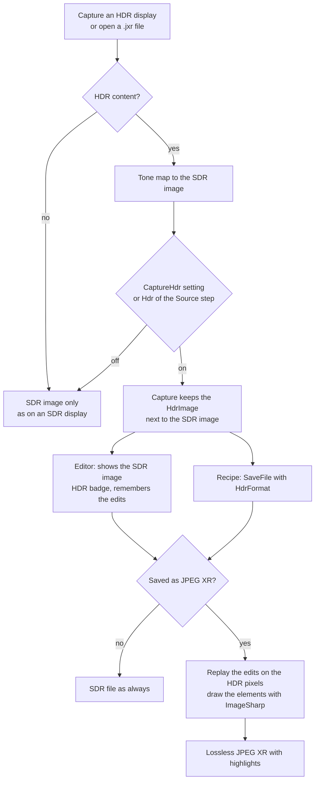
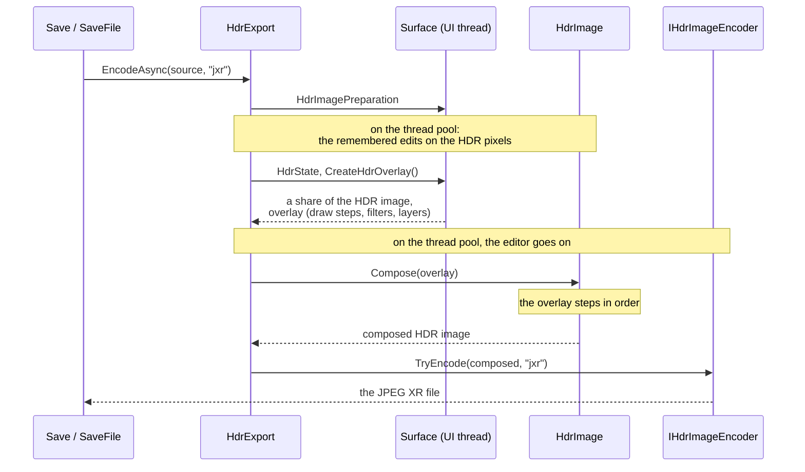
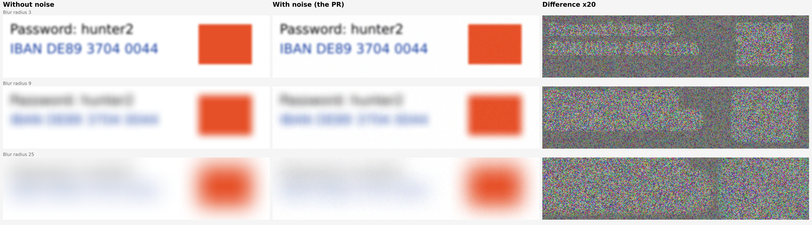

# HDR captures and files

Greenshot captures HDR displays, shows the capture tone mapped in the editor and saves it as an HDR file (JPEG XR) with its
highlights. Everything you draw in the editor is drawn on the HDR pixels too. This document explains how that works and where the
code is.

## SDR and HDR in short

**SDR** (standard dynamic range) is what screens and image files have shown for decades. Each pixel has red, green and blue values
from 0 to 255 (8 bits each, together millions of colors), and 255 means "as bright as white". White is the brightest a pixel can be,
so a sunlit sky and a white page are both just white. PNG, JPEG and BMP files and the clipboard are SDR.

**HDR** (high dynamic range) screens can show more than white: highlights, such as the sun in a video or a lamp in a game, are much
brighter than a white page next to them. Windows describes such pixels with decimal numbers in linear light (scRGB), where 1.0 is
80 nits (a measure of brightness) and values can go far above the white of the page. The brightness Windows uses for a white page
on an HDR screen is the **SDR white level**, e.g. 240 nits (3.0). A pixel above it is a highlight.

In this document:

- the **SDR image** is the normal image of a capture: 8 bits per color, white is the brightest. Every destination, the editor and the
  clipboard use it;
- the **HDR image** keeps the decimal values of the HDR screen, highlights included. Only an HDR file (JPEG XR) can hold it;
- **tone mapping** turns HDR values into the SDR image: it picks which brightness becomes white and fits the brighter values below
  it, so the image can be shown on any screen.

Tone mapping is a compromise, it can't make HDR fit into SDR without losing something:

- **Highlights lose their brightness.** In the SDR image nothing is brighter than white, so a highlight is at most as bright as a
  white page. Highlights close to each other in brightness are squeezed together and lose detail.
- **Either the highlights or the normal content suffers.** If the white of the page stays white, the highlights are compressed into
  the little room above the page's brightness. If the brightest highlight becomes white instead, everything else gets darker: a white
  page turns light gray. Greenshot chooses by how much of the capture is brighter than SDR white (see below).
- **Some colors are lost.** HDR can hold colors outside the sRGB range (more saturated reds and greens). The SDR image can't, they
  are moved to the nearest sRGB color.
- **It can't be undone.** The SDR image doesn't hold what was lost, so it can't be turned back into HDR. That is why the capture
  keeps the HDR image next to it when an HDR file may be wanted.

## The idea in short

1. **Capture or open a file.** Greenshot takes the capture with Windows.Graphics.Capture (DirectX), or opens a JPEG XR file.
2. **Tone map for SDR.** If there is HDR content, the HDR pixels are tone mapped to an SDR image. That image works on any
   screen, in the editor and in every destination, exactly as before.
3. **Keep the HDR pixels.** Depending on the setting or the recipe, the capture also keeps its HDR pixels as an `HdrImage`, next to
   the SDR image (`ICapture.HdrImage`). Nothing else uses them, they are only available.
4. **Save as HDR.** When a capture is saved in a format which supports HDR (JPEG XR) and it has HDR content, the HDR pixels are
   written instead of the SDR image.
5. **Edit the SDR image, remember the changes.** The editor shows and edits the tone-mapped SDR image, with an HDR badge in the
   status bar to the right of the size. Every change of the image (crop, rotate, effects) is remembered as an edit for the HDR
   image, and every element stays on the surface as it is.
6. **Replay for the HDR file.** When the HDR file is written, the remembered edits are done on the HDR pixels. Then the elements are
   drawn again, in their order, with ImageSharp on the HDR pixels, with a white that looks right next to the HDR content.

## 1. Capturing

Only the DirectX way of taking screenshots can see HDR (*Take screenshots with DirectX* on the Expert tab). A backend which can
deliver HDR implements `IHdrScreenCaptureBackend` (`GraphicsCaptureBackend`). Windows.Graphics.Capture delivers each HDR display as
an FP16 texture in scRGB: linear light with the sRGB primaries, where 1.0 is 80 nits. Values above the SDR white level of the
display are highlights.

The capture keeps the HDR pixels only when it is asked to:

- the setting `CaptureHdr` in greenshot.ini (Core section), for the normal captures;
- the `Hdr` parameter of a recipe's `Source` step (screen, region, window, last region). Without it, the step follows the setting.

The live screen (`ScreenMode` `Live` of the `Source` step, or *Freeze the screen while selecting* off) shows HDR content as it is on
the screen while you select, so it is the better choice for an HDR capture.

## 2. Tone mapping to the SDR image

The SDR image is what every destination, the editor and the clipboard get, so it has to look right on an SDR screen.

- `HdrContent` decides which brightness becomes white. Without HDR content SDR white stays white, so normal windows keep their
  exact colors. When much of the capture is brighter (an HDR video or game) the display's peak becomes white, as the Xbox Game Bar
  does: the highlights keep their detail, but SDR content in the same capture (a window next to the video) looks darker than on the
  screen. In between it blends by the share of pixels brighter than SDR white. With only a few highlights SDR white stays white and
  the highlights are clipped or compressed.
- `HdrToneMapper` does it on the GPU with the Direct2D effects Microsoft uses in its HDR samples (HDR tone map, then white level
  adjustment), into an SDR texture (8 bits per color, sRGB).
- `HdrImageToneMapping` tone maps an HDR image which isn't on the screen, e.g. an opened JPEG XR file. Without a Direct3D device it
  does it on the CPU, with the same white and the highlights clipped.

A capture has **HDR content** when a channel is brighter than SDR white or outside the sRGB colors. This is decided at the capture.
Without HDR content there is no `HdrImage`, and the capture is a normal one.

## 3. The HDR image of a capture

`HdrImage` (Greenshot.Base/Core) holds the HDR pixels as an ImageSharp `Image<HalfVector4>`, which is bit for bit the FP16 texture,
with straight alpha. It is one image of the captured area, like the SDR image: when the area spans HDR and SDR displays, the parts of
the SDR displays are put in from the SDR image at the SDR white level (`HdrImage.Combine`), so they look as they did on the screen.

This join waits until the area is known. A capture of the screen first keeps only the HDR images of its HDR displays (`HdrParts`,
`ICapture.HdrParts`), e.g. the frozen screen while the region is selected. Cropping the capture to the selection (`Capture.Crop`)
joins only that area, and a capture used as it is (the whole screen) is joined when its `HdrImage` is first read. An area with no
HDR content (e.g. only on an SDR display, or only normal windows) gets no `HdrImage`.

**Memory:** the HDR image of the captured area takes 8 bytes per pixel (twice the SDR image), also for the parts of SDR displays in
it. While the region is selected on the frozen screen, only the HDR displays are held, at 8 bytes per pixel. A capture without HDR
content costs nothing extra. For example, a region of 1920x1080 takes about 16 MB more; the whole screen of three 4K displays takes
about 200 MB more, also when only one of them is HDR.

The `HdrImage` belongs to its SDR image (`BelongTo`). Copies of a capture or a surface share the pixels, each with its own
`HdrImage`.

`HdrState` tells what can be done with it. Recipes see it as `payload.hdr`, the editor shows it with the badge:

| State | Meaning |
|---|---|
| `None` | No HDR content: not on an HDR display, the capture doesn't keep HDR, or nothing brighter than SDR white or outside sRGB |
| `Available` | It can be saved as an HDR file |
| `Lost` | It had HDR content, but a change of the image can't be done on the HDR pixels (monochrome, reduce colors) |

## 4. Saving an HDR file

The HDR file is JPEG XR, lossless (`IHdrImageEncoder`, written with WIC by the editor's `WicHdrImageEncoder`). JPEG XR is part of
Windows and its brightness (1.0 is 80 nits) is the same in every viewer. JPEG XL is left out for now: the Windows encoder doesn't
write the intensity target, so viewers outside Windows show its files too bright.

`HdrExport` writes the file for all ways of saving:

- the editor's Save and Save as with JPEG XR. Without HDR content the editor asks before it saves an SDR JPEG XR;
- the file destinations;
- the `HdrFormat` parameter of the recipe step `SaveFile`: `None`, `Auto` or `Jxr`. With HDR content it saves JPEG XR, without it
  the normal file. Recipes can use `NoHdrNote` of the `Notification` step to tell the user. The example recipes
  [hdr_region_to_file](examples/hdr_region_to_file.gsrecipe.json) and [hdr_window_to_file](examples/hdr_window_to_file.gsrecipe.json)
  show how.

Opening a JPEG XR file (`IHdrImageDecoder`, `WicHdrImageDecoder`) works the other way round: the file becomes an `HdrImage`, tone
mapped to the SDR image by `HdrImageToneMapping`, and the editor treats it like an HDR capture.

## 5. The editor: the SDR image and the edits

The editor works on the SDR image as always. It never shows the HDR pixels, but it keeps what it needs to make the HDR file
later:

- **Changes of the image** (crop, rotate, resize, cut out, effects) are remembered as `IImageEdit`s (`ImageEdits` in
  Greenshot.Base/Effects). They are ImageSharp operations, which work for any pixel type, and they are only done when an HDR file
  is written. Undo removes them again.
- **Every edit is done on both images the same way**, also across the edge of a display: the HDR image is one image like the SDR
  image (see 3).
- **The room an edit adds** (a border, a drop shadow, a bigger canvas, the room for the shadow of torn edges) is taken from the new
  SDR image at the SDR white level when the edit is made (`ImageEdits.PlaceInRoom`).
- **The torn edge effect** is drawn on the HDR pixels: the same teeth, shadow and background (`CutDrawing.TornEdge`).
- **Applying torn edges or a cut mark to the image** draws the element on the HDR pixels (`ImageEdits.Draw`, `HdrImage.Draw`)
  with the same steps as when it is saved as an element (see 6), so the HDR file stays the same.
- **Color effects** (grayscale, invert, adjust, remove transparency) are done on the HDR pixels in linear light, so the highlights
  stay.
- **Monochrome and reduce colors** make an SDR result by nature (black and white, a palette). The capture loses its HDR content then (`Lost`), and the badge
  says so.
- **Elements** (rectangles, text, arrows, speech bubbles, highlighters, obfuscation...) stay on the surface as they are. They are
  drawn on the HDR pixels only when the file is written.

## 6. Replaying: the elements on the HDR pixels

`Surface.CreateHdrOverlay` turns the elements into an `HdrOverlay`, a list of steps in z-order:

- **Draw:** an element drawn with ImageSharp on the HDR pixels (`ElementDrawing`, using the routines in
  Greenshot.Base/ImageSharpDrawing). This covers every element type of the editor, also torn edges, cut marks and the mouse cursor.
- **Filter:** the filters of highlighters and obfuscation (`ElementImageFilters`), done on the HDR pixels so the area keeps its
  brightness. Blur, pixelate, the highlighter, area highlight, grayscale and the magnifier work this way, as strong as in the editor
  and not finer than the levels of the SDR image. Blur and pixelate add the same noise as in the editor (`BlurNoise`), so neither
  can be undone by calculation. Guessing the text and comparing its blur still works; only a large radius, pixelate or a
  solid fill hides text from that. The noise is up to 3 levels per color, which the eye doesn't see:
  
- **Layer:** an SDR layer, only for element types of plugins which have no ImageSharp drawing.

`HdrImage.Compose` puts it together: the HDR tiles, the SDR displays from the SDR image at SDR white, then each step in order.

### The white of the elements

An element which is white in the editor can't simply be SDR white in the HDR file. Next to the HDR content it looks gray there,
because the editor shows the capture tone mapped and its white is brighter than SDR white. The full white of the tone mapping is
too bright on the other hand. Elements use the geometric middle of the two: `sqrt(SDR white × white of the tone mapping)`. The
white of the tone mapping comes from `HdrContent`, measured on the composed image. Filters and the SDR displays keep SDR white.

### Drawing with ImageSharp

The drawing code uses only ImageSharp's fill, pen, text and image drawing, not a copy of GDI+. The rule is "would a user notice":
the HDR file looks like the editor, small differences are fine (all lines are anti-aliased, mixing happens in linear light).
Elements are drawn into an `Image<RgbaVector>`, because ImageSharp blends `HalfVector4` on its scaled values, which is wrong for
HDR. The knowledge about HDR is only in `ImageValues`, so the same routines can draw into an SDR image later. This is a step
toward dropping System.Drawing.

## Where the code is

| Part | Where |
|---|---|
| HDR pixels of a capture | `Greenshot.Base/Core/HdrImage.cs`, `HdrState.cs` |
| Capturing HDR | `Greenshot.Base/Capturing/IHdrScreenCaptureBackend.cs`, `GraphicsCaptureBackend.cs`, `Native/WindowsGraphicsCaptureInterop.cs` |
| Tone mapping | `Greenshot.Base/Native/HdrContent.cs`, `HdrToneMapper.cs`, `HdrImageToneMapping.cs` |
| Remembered edits | `Greenshot.Base/Effects/ImageEdits.cs`, `LinearColorEffects.cs`, `FloatPixels.cs` |
| Elements on HDR pixels | `Greenshot.Base/Core/HdrOverlay.cs`, `Greenshot.Base/ImageSharpDrawing/`, `Greenshot.Editor/Drawing/ElementDrawing.cs`, `Greenshot.Editor/Drawing/Filters/ElementImageFilters.cs` |
| Writing and reading files | `Greenshot.Base/Core/Export/HdrExport.cs`, `Greenshot.Editor/FileFormatHandlers/WicHdrImageEncoder.cs`, `WicHdrImageDecoder.cs` |
| Recipes | `Greenshot.Base/Recipes/HdrOutput.cs`, the `Source`, `SaveFile` and `Notification` steps |

## Not (yet) supported

- HDR on the clipboard: the clipboard gets the SDR image.
- HDR in `.greenshot` files: they keep the SDR image. This waits for the new document model.
- JPEG XL, see above.
