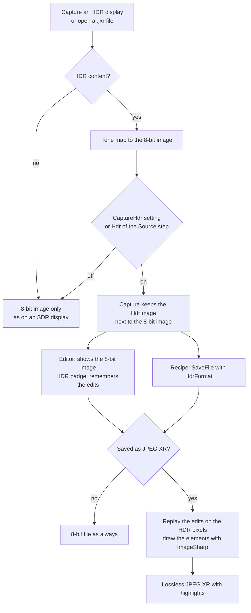
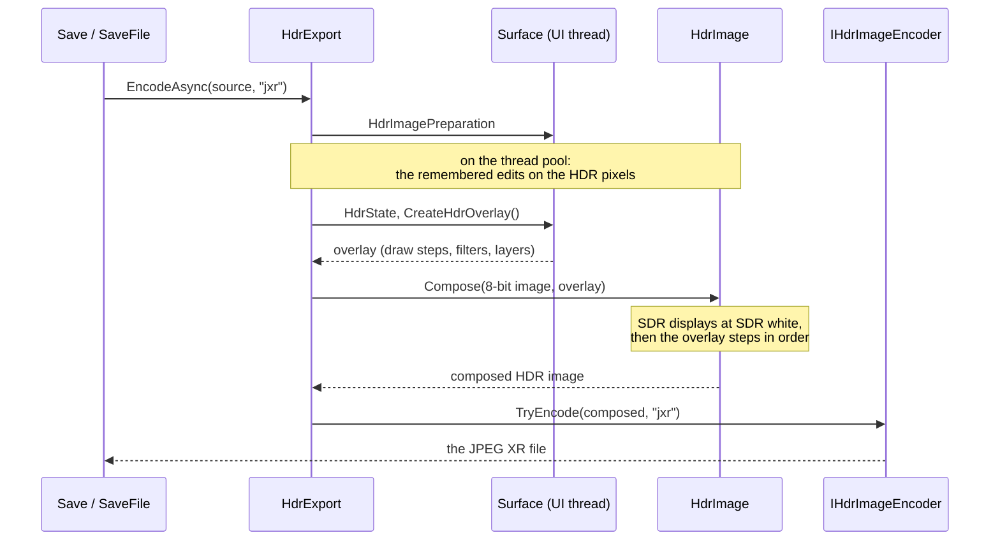
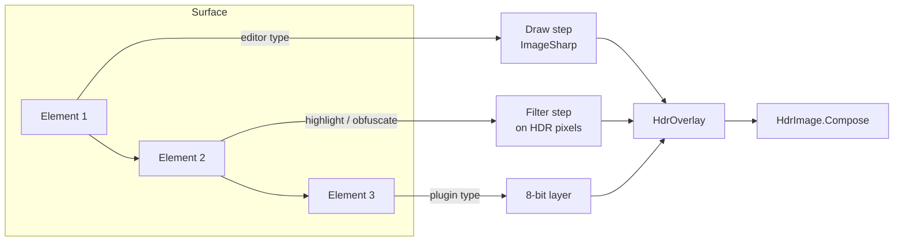

# HDR captures and files

Greenshot captures HDR displays, shows the capture tone mapped in the editor and saves it as an HDR file (JPEG XR) with its
highlights. Everything you draw in the editor is drawn on the HDR pixels too. This document explains how that works and where the
code is.

## The idea in short

1. **Capture or open a file.** Greenshot takes the capture with Windows.Graphics.Capture (DirectX), or opens a JPEG XR file.
2. **Tone map for SDR.** If there is HDR content, the HDR pixels are tone mapped to an 8-bit image. That image works on any
   screen, in the editor and in every destination, exactly as before.
3. **Keep the HDR pixels.** Depending on the setting or the recipe, the capture also keeps its HDR pixels as an `HdrImage`, next to
   the 8-bit image (`ICapture.HdrImage`). Nothing else uses them, they are only available.
4. **Save as HDR.** When a capture is saved in a format which supports HDR (JPEG XR) and it has HDR content, the HDR pixels are
   written instead of the 8-bit image.
5. **Edit the 8-bit image, remember the changes.** The editor shows and edits the tone-mapped 8-bit image, with an HDR badge in the
   status bar to the right of the size. Every change of the image (crop, rotate, effects) is remembered as an edit for the HDR
   image, and every element stays on the surface as it is.
6. **Replay for the HDR file.** When the HDR file is written, the remembered edits are done on the HDR pixels. Then the elements are
   drawn again, in their order, with ImageSharp on the HDR pixels, with a white that looks right next to the HDR content.

## 1. Capturing

Only the DirectX way of taking screenshots can see HDR (*Take screenshots with DirectX* on the Expert tab). A backend which can
deliver HDR implements `IHdrScreenCaptureBackend` (`GraphicsCaptureBackend`). Windows.Graphics.Capture delivers each HDR display as
an FP16 texture in scRGB: linear light with the sRGB primaries, where 1.0 is 80 nits. Values above the SDR white level of the
display are highlights.

The capture keeps the HDR pixels only when it is asked to:

- the setting `CaptureHdr` in greenshot.ini (Core section), for the normal captures;
- the `Hdr` parameter of a recipe's `Source` step (screen, region, window, last region). Without it, the step follows the setting.

The live screen (`ScreenMode` `Live` of the `Source` step, or *Freeze the screen while selecting* off) shows HDR content as it is on
the screen while you select, so it is the better choice for an HDR capture.

## 2. Tone mapping to the 8-bit image

The 8-bit image is what every destination, the editor and the clipboard get, so it has to look right on an SDR screen.

- `HdrContent` decides which brightness becomes white. Without HDR content SDR white stays white, so normal windows keep their
  exact colors. When much of the capture is brighter (an HDR video or game) the display's peak becomes white, as the Xbox Game Bar
  does. In between it blends by the share of pixels brighter than SDR white.
- `HdrToneMapper` does it on the GPU with the Direct2D effects Microsoft uses in its HDR samples (HDR tone map, then white level
  adjustment), into an 8-bit sRGB texture.
- `HdrImageToneMapping` tone maps an HDR image which isn't on the screen, e.g. an opened JPEG XR file. Without a Direct3D device it
  does it on the CPU, with the same white and the highlights clipped.

A capture has **HDR content** when a channel is brighter than SDR white or outside the sRGB colors. This is decided at the capture.
Without HDR content there is no `HdrImage`, and the capture is a normal one.

## 3. The HDR image of a capture

`HdrImage` (Greenshot.Base/Core) holds the HDR pixels as an ImageSharp `Image<HalfVector4>`, which is bit for bit the FP16 texture,
with straight alpha. It keeps only what HDR displays showed: one tile per HDR display, at its place in the capture. The parts of SDR
displays are already in the 8-bit image, so they aren't kept twice. They are put in at the SDR white level when the HDR file is
written.

The `HdrImage` belongs to its 8-bit image (`BelongTo`). Copies of a capture or a surface share the pixels, each with its own
`HdrImage`.

`HdrState` tells what can be done with it. Recipes see it as `payload.hdr`, the editor shows it with the badge:

| State | Meaning |
|---|---|
| `None` | No HDR content: not on an HDR display, the capture doesn't keep HDR, or nothing brighter than SDR white or outside sRGB |
| `Available` | It can be saved as an HDR file |
| `Lost` | It had HDR content, but a change of the image can't be done on the HDR pixels (monochrome, reduce colors) |

## 4. Saving an HDR file

The HDR file is JPEG XR, lossless (`IHdrImageEncoder`, written with WIC by the editor's `WicHdrImageEncoder`). JPEG XR is part of
Windows and its brightness (1.0 is 80 nits) is the same in every viewer. JPEG XL is left out for now: the Windows encoder doesn't
write the intensity target, so viewers outside Windows show its files too bright.

`HdrExport` writes the file for all ways of saving:

- the editor's Save and Save as with JPEG XR. Without HDR content the editor asks before it saves an 8-bit JPEG XR;
- the file destinations;
- the `HdrFormat` parameter of the recipe step `SaveFile`: `None`, `Auto` or `Jxr`. With HDR content it saves JPEG XR, without it
  the normal file. Recipes can use `NoHdrNote` of the `Notification` step to tell the user. The example recipes
  [hdr_region_to_file](examples/hdr_region_to_file.gsrecipe.json) and [hdr_window_to_file](examples/hdr_window_to_file.gsrecipe.json)
  show how.

Opening a JPEG XR file (`IHdrImageDecoder`, `WicHdrImageDecoder`) works the other way round: the file becomes an `HdrImage`, tone
mapped to the 8-bit image by `HdrImageToneMapping`, and the editor treats it like an HDR capture.

## 5. The editor: the 8-bit image and the edits

The editor works on the 8-bit image as always. It never shows the HDR pixels, but it keeps what it needs to make the HDR file
later:

- **Changes of the image** (crop, rotate, resize, cut out, effects) are remembered as `IImageEdit`s (`ImageEdits` in
  Greenshot.Base/Effects). They are ImageSharp operations, which work for any pixel type, and they are only done when an HDR file
  is written. Undo removes them again.
- **What isn't in the HDR image** comes from the 8-bit image when the file is written, like an SDR display: the room a border, a
  drop shadow or a bigger canvas adds, the teeth of torn edges.
- **Color effects** (grayscale, invert, adjust, remove transparency) are done on the HDR pixels in linear light, so the highlights
  stay.
- **Monochrome and reduce colors** make an 8-bit result by nature. The capture loses its HDR content then (`Lost`), and the badge
  says so.
- **Elements** (rectangles, text, arrows, speech bubbles, highlighters, obfuscation...) stay on the surface as they are. They are
  drawn on the HDR pixels only when the file is written.

## 6. Replaying: the elements on the HDR pixels

`Surface.CreateHdrOverlay` turns the elements into an `HdrOverlay`, a list of steps in z-order:

- **Draw:** an element drawn with ImageSharp on the HDR pixels (`ElementDrawing`, using the routines in
  Greenshot.Base/ImageSharpDrawing). This covers every element type of the editor, also torn edges, cut marks and the mouse cursor.
- **Filter:** the filters of highlighters and obfuscation (`ElementImageFilters`), done on the HDR pixels so the area keeps its
  brightness. Blur, pixelate, the highlighter, area highlight, grayscale and the magnifier work this way, as strong as in the editor
  and not finer than its 8-bit levels.
- **Layer:** an 8-bit layer, only for element types of plugins which have no ImageSharp drawing.

`HdrImage.Compose` puts it together: the HDR tiles, the SDR displays from the 8-bit image at SDR white, then each step in order.

### The white of the elements

An element which is white in the editor can't simply be SDR white in the HDR file. Next to the HDR content it looks gray there,
because the editor shows the capture tone mapped and its white is brighter than SDR white. The full white of the tone mapping is
too bright on the other hand. Elements use the geometric middle of the two: `sqrt(SDR white × white of the tone mapping)`. The
white of the tone mapping comes from `HdrContent`, measured on the composed image. Filters and the SDR displays keep SDR white.

### Drawing with ImageSharp

The drawing code uses only ImageSharp's fill, pen, text and image drawing, not a copy of GDI+. The rule is "would a user notice":
the HDR file looks like the editor, small differences are fine (all lines are anti-aliased, mixing happens in linear light).
Elements are drawn into an `Image<RgbaVector>`, because ImageSharp blends `HalfVector4` on its scaled values, which is wrong for
HDR. The knowledge about HDR is only in `ImageValues`, so the same routines can draw into an 8-bit image later. This is a step
toward dropping System.Drawing.

## Where the code is

| Part | Where |
|---|---|
| HDR pixels of a capture | `Greenshot.Base/Core/HdrImage.cs`, `HdrState.cs` |
| Capturing HDR | `Greenshot.Base/Capturing/IHdrScreenCaptureBackend.cs`, `GraphicsCaptureBackend.cs`, `Native/WindowsGraphicsCaptureInterop.cs` |
| Tone mapping | `Greenshot.Base/Native/HdrContent.cs`, `HdrToneMapper.cs`, `HdrImageToneMapping.cs` |
| Remembered edits | `Greenshot.Base/Effects/ImageEdits.cs`, `LinearColorEffects.cs`, `FloatPixels.cs` |
| Elements on HDR pixels | `Greenshot.Base/Core/HdrOverlay.cs`, `Greenshot.Base/ImageSharpDrawing/`, `Greenshot.Editor/Drawing/ElementDrawing.cs`, `Greenshot.Editor/Drawing/Filters/ElementImageFilters.cs` |
| Writing and reading files | `Greenshot.Base/Core/Export/HdrExport.cs`, `Greenshot.Editor/FileFormatHandlers/WicHdrImageEncoder.cs`, `WicHdrImageDecoder.cs` |
| Recipes | `Greenshot.Base/Recipes/HdrOutput.cs`, the `Source`, `SaveFile` and `Notification` steps |

## Not (yet) supported

- HDR on the clipboard: the clipboard gets the 8-bit image.
- HDR in `.greenshot` files: they keep the 8-bit image. This waits for the new document model.
- JPEG XL, see above.
