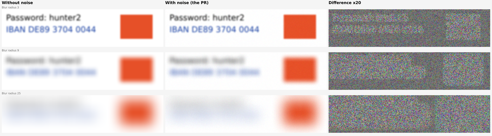

# Hiding text: blur, pixelate and Redact Text

Greenshot hides text in a capture in four ways:

- **Blur and pixelate** from the editor's toolbar: draw the area over the text.
- **Redact Text** (*Effects*, *Redact Text...* in the editor): finds text with OCR and covers every match.
- **The `TextEffect` recipe step:** the same for a recipe, with the effects `Blur`, `Pixelize` and `Redact` (a filled rectangle).
- **A filled rectangle:** the only way that hides the text completely, see [What blur and pixelate don't protect](#what-blur-and-pixelate-dont-protect).

## Redact Text

The window searches the text of the capture and covers each match:

- **Search for:** the text to find. The search runs while you type (from 3 characters on) or with *Search*.
- **Use Regular Expression** and **Case Sensitive**, for example `\d{3}-\d{2}-\d{4}`.
- **Search in:** *Words* covers only the matching words, *Lines* the whole line they are in.
- **Effect:** pixelate, blur, highlight text or magnify, with its strength or color.
- **Advanced Settings:** padding (a percentage of the match, also negative) and an offset in pixels, for text that OCR places a little off.

While the window is open, the matches show with the chosen effect. *Apply* keeps them as normal elements, which you can still move,
change or delete; *Cancel* removes them. The window remembers its settings.

The window uses the text the capture already has (from a drawn obfuscation, a recipe OCR step or capturing text). Otherwise it runs OCR
once, with the engine chosen in the settings (Windows OCR or [RapidOCR](text-recognition.md#choosing-the-ocr-engine)).

## How strong blur and pixelate are

A fixed blur radius or pixel size that hides small text leaves large text readable, so the strength follows the text:

- **Redact Text window:** the *Blur radius* and *Pixel size* sliders are a percentage of the height of the OCR line a match is in.
  Each match gets its own value, so a heading gets a stronger effect than the small print below it.
  Defaults: blur radius 50 % and pixel size 75 % of the line height (expert settings `BlurRadiusTextHeightPercent` and
  `PixelSizeTextHeightPercent`).
- **An obfuscation you draw:** when you draw it, the obfuscation gets the same percentage of the height of the OCR lines it covers
  (the median, a line counts when at least half its height is inside). When the capture has no OCR lines yet, the first obfuscation
  you draw starts OCR of the image once, in the background. Until it is done, the obfuscation has the last used value of the toolbar;
  then it gets the value for its text, unless you changed the value meanwhile. The obfuscations drawn after that, and the Redact Text
  window, use the lines found: OCR runs at most once per image, also when it found nothing or failed. Without an OCR engine, when OCR
  fails, or without OCR lines under it, the obfuscation keeps the last used value of the toolbar. Afterwards the toolbar changes the
  value as usual.
- **The OCR badge:** next to the size (and the HDR badge) in the editor's status bar, *OCR* shows whether the text of the capture is
  known: highlighted when there is text, grey when no text was found, grey and struck through when OCR failed (the tooltip says why).
  Without OCR lines, before any OCR and while it runs, the badge isn't shown.
- **Recipes:** the `TextEffect` step takes `BlurRadiusTextHeightPercent` and `PixelSizeTextHeightPercent` (same defaults).

Why these values: from about half the text height on, blurred or pixelated text can't be read by eye; at a quarter (for example
a blur radius of 3 on 12 px text) it often still can.

## The noise in blur and pixelate

Both effects add a little random noise, so what they cover can't be calculated back:

- **Blur:** undoing a blur makes small differences big, so the blur gets up to 3 levels (of 255) up or down per pixel and color. The
  eye doesn't see it. The noise comes from a random key which is never stored: the same blur gets the same noise at every repaint, in
  the export and in the HDR file, and every blur gets its own.
- **Pixelate:** the blocks are not a regular grid. Their edges move by up to a third of the pixel size, at random, and every row of
  blocks gets its own edges, so the blocks can't be lined up with the text. Each block gets a random color offset of up to 12 levels,
  and each pixel up to 3 more. A block of one color (no text under it) stays exactly that color.

HDR files get the same noise as the editor, see [hdr.md](hdr.md).

## What blur and pixelate don't protect

Someone who knows the font, for example of a known application, can render candidate texts, apply the same effect and compare:
the candidate that looks most like the covered text is their guess. In our tests with a 4-digit number among 2000 candidates, this
guess was right for blur at every radius, up to the full text height. For pixelate it was right up to a pixel size of about three
quarters of the text height (the default) and wrong from there on. The noise stops calculating the blur back, not this guessing. For short secrets like PINs,
card numbers or passwords, cover the text with a filled rectangle (the `Redact` effect of the `TextEffect` recipe step).

**The recognized text still holds what you hid.** The OCR lines stay with the capture, including the text under an obfuscation or a
filled rectangle. They go with the image when *Text* is chosen for the image metadata (expert setting `ExportMetadata`, off by
default), and the OCR destination, the AI tool and the recipe `Ocr` step return them too.

## Limits

- Redact Text and the fitted strength need an OCR engine: Windows OCR with an installed OCR language, or RapidOCR.
- They are as good as the OCR: text which OCR doesn't find isn't covered, and its height isn't known.
