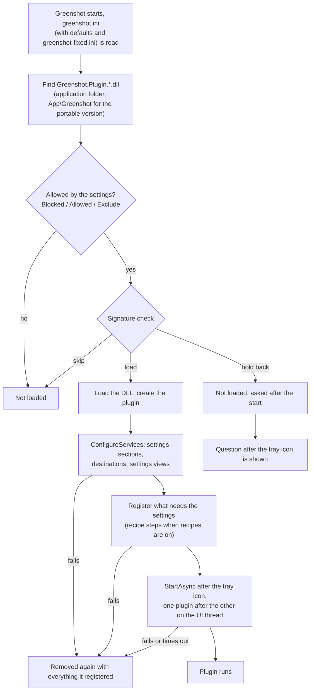
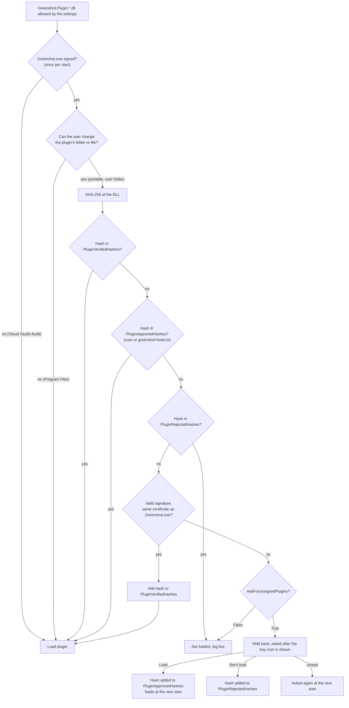

# How Greenshot loads plugins

What happens with a plugin from the moment Greenshot finds its file until it runs, and which settings decide on the way.
Greenshot Light has no plugins. Which plugins and destinations are switched on or off is described in
[plugins-and-destinations.md](plugins-and-destinations.md).

## Overview

1. **Find:** every `Greenshot.Plugin.*.dll` in the application folder and its subfolders (the installer puts each plugin in
   `Plugins\<name>\`). The plugin's name is the part of the file name after `Greenshot.Plugin.`: `Box` for `Greenshot.Plugin.Box.dll`.
2. **Settings:** `BlockedPluginNames`, `AllowedPluginNames` and `ExcludePluginNames` decide by that name, before the file is read,
   see [plugins-and-destinations.md](plugins-and-destinations.md).
3. **Signature check:** see below.
4. **Load and register:** the DLL is loaded and the plugin registers its settings sections (filled from the already read
   greenshot.ini), destinations, settings views and recipe steps.
5. **Start:** after the tray icon is shown, the plugins start one after the other on the UI thread, which handles its messages
   between them. A plugin which fails to register or start (or doesn't start within its time limit) is logged and removed again
   with everything it registered: services, settings views, recipe steps and drawables.

## The signature check

Release builds of Greenshot and its plugins are signed with the Greenshot code signing certificate. A plugin loads when it is
signed with the same certificate as Greenshot.exe; any other plugin (not signed, a broken signature, another signer) is held back
and the user is asked. Builds from Visual Studio aren't signed: when Greenshot.exe has no valid signature the check is off.

The check only runs where it can help: for a plugin in a folder the user can change (the portable version, an installation in a
user folder). In an installation under Program Files only an administrator can place or replace a plugin, so it loads without the
check. Greenshot reads the permissions of the plugin's folder and file for the user without administrator rights, also when
Greenshot itself was started as administrator.

- **Cost:** checking a signature takes about 6 ms per file (revocation isn't checked, that can go online and take 200 ms or more),
  a SHA-256 about 0.1-0.3 ms. A plugin whose hash passed the check once isn't checked again until it changes, so a normal start
  only computes the hashes. `PluginVerifiedHashes` keeps the hashes of the plugins found at the last start.
- **The question** shows the plugin's name, folder, signer and SHA-256. *Load* approves exactly this file: an update has a new hash
  and is checked again. The plugin loads at the next start, loading it later would miss the registration of its settings and
  destinations.
- **Only the plugin DLL** is checked, not the libraries in its folder (some are signed by others, e.g. Microsoft).
- **Limits:** the lists are in greenshot.ini, which every program of the user can change. The check catches a plugin which was
  placed or replaced in a folder the user can write to, not a program which also edits greenshot.ini (that program could replace
  Greenshot.exe in the same folder as well).
- **Plugins tab:** the settings show who signed each loaded plugin. A plugin signed with the certificate of Greenshot.exe is shown
  in green with a check mark; a plugin which was held back shows *Not signed*.

## For administrators

These keys only matter for plugins in a folder the user can change; plugins under Program Files load without the check.

| Key | What it does |
|---|---|
| `PluginApprovedHashes` | SHA-256 of plugins which aren't signed like Greenshot.exe but may load. In greenshot-fixed.ini, users can't approve others. |
| `PluginRejectedHashes` | SHA-256 of plugins the user chose not to load. |
| `PluginVerifiedHashes` | Kept by Greenshot: hashes which passed the signature check. |
| `AskForUnsignedPlugins` | `False` in greenshot-fixed.ini: no question, a plugin which isn't signed like Greenshot.exe only loads when `PluginApprovedHashes` lists it. |

**Administrator settings…** in the settings (Plugins or Destinations tab) adds the hashes approved on this PC to the lines for
greenshot-fixed.ini, and *Don't ask about plugins which aren't signed* adds `AskForUnsignedPlugins=False`.
